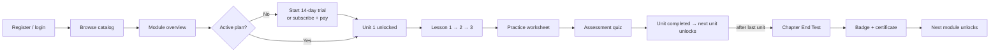
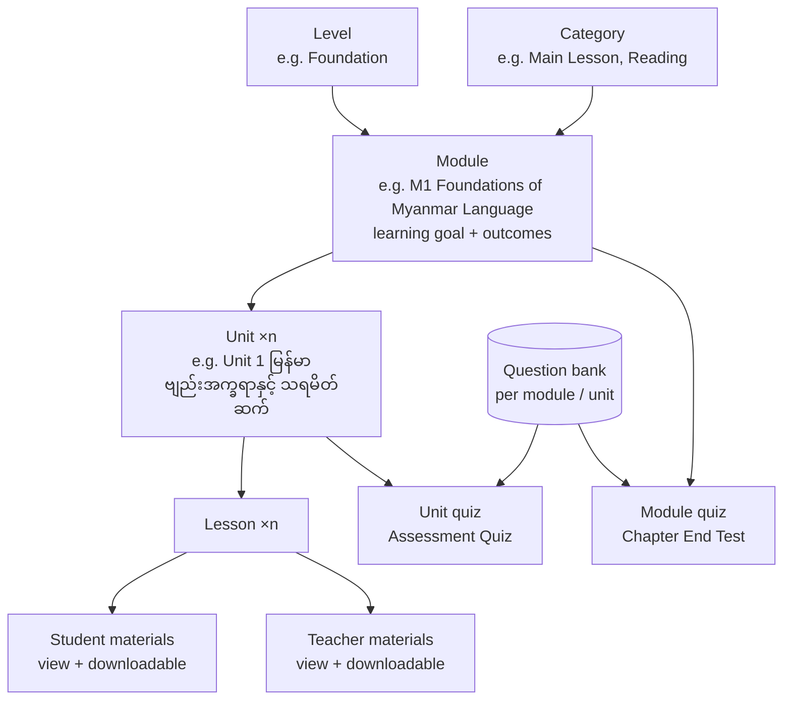
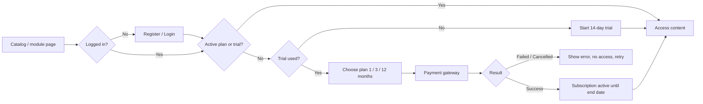
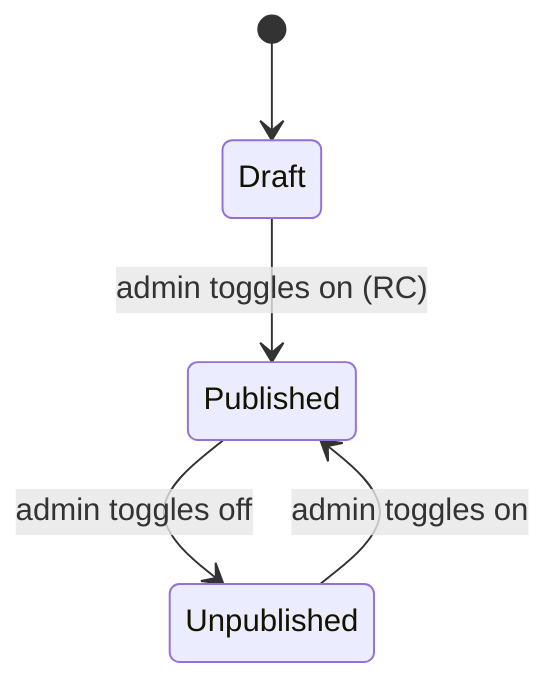
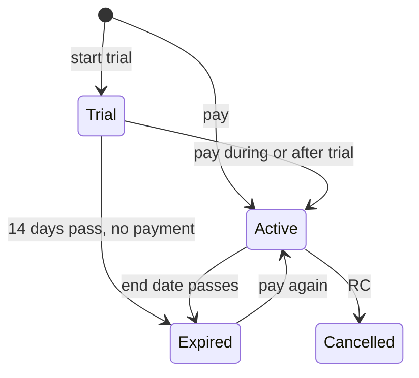

# Colour Balloons · MyanmarSar Hub — Product Requirements Document (PRD)

| Item | Value |
| --- | --- |
| Product | Colour Balloons · MyanmarSar Hub (online learning platform + LMS for the Myanmar language) |
| Document | PRD v0.1 (draft for review) |
| Date | 3 October 2026 |
| Prepared for | Kay Zin, Colour Balloons |
| Status | Draft. Many business rules are marked **Requires Confirmation** and listed in Section 24. |

---

## Source Analysis Summary

### 1. Documents reviewed

| Code | Source | Type | Date / version | What it gives us |
| --- | --- | --- | --- | --- |
| **[QT]** | *Option 2 – Bulk Import.pdf*: TrioDev Project Proposal & Quotation Q-2026-0806-2 | General requirements (contract scope) | 6 Aug 2026, valid until 5 Sep 2026 | Phase 1 scope, roles, content structure, deliverables, out-of-scope list |
| **[PM]** | *MyanmarSar Hub Product Model* (.md and .html, same content) | General requirements (business model) | Sep 2026, "proposed for discussion" | Student vs teacher access, resource delivery rules, pricing, trial, 3-phase roadmap |
| **[CUR]** | *Colour_Balloons_MyanmarSar_M1_M2_Curriculum_Draft.docx* | General requirements (curriculum) | Draft | M1 and M2 goals, outcomes, 8 units each, unit and module completion structure |
| **[FLOW]** | *curriculum_setup_flow (1).svg* | General requirements (diagram) | Draft | Content hierarchy, unit progression, module completion gating |
| **[DB]** | *lms_schema.sql* (PostgreSQL, 13 tables) | Database design | Current | Users, levels, categories, media, modules, units, lessons, lesson materials, question bank, quizzes |
| **[FIG]** | Figma file *Colour-Balloons* (5 linked sections: MODULE, UNIT, LESSON, QUIZ, QUESTION), 67 screen frames | Figma design | Current | Admin back-office screens for content management only |

> There is no single "general requirements document". QT, PM, CUR and FLOW together play that role, and they do not fully agree with each other.

### 2. Major modules identified

* **Well defined (DB + Figma + docs):** Module, Unit, Lesson, Lesson Materials, Question Bank (5 question types), Quiz management. All admin-side.
* **Defined in DB only (no UI):** Levels, Categories, Users, Media assets, module price fields, badge/certificate image fields.
* **Defined in docs only (no DB, no UI):** Learner experience (catalog, lesson player, progress, unlocking), quiz taking and results, student subscription + free trial, payment, entitlement/access control, badges and certificates, teacher layer, bulk import, reporting, reminders/notifications.

### 3. Major inconsistencies (full list in Section 2.3)

1. **Content hierarchy.** QT says *Course → Level → Module (M1–M6) → Lesson*. DB, Figma, CUR and FLOW use *Level + Category → Module → Unit → Lesson*.
2. **Roles.** QT has one "Resource Accessor" role for students and teachers with equal access. PM separates students and teachers with different content. DB and Figma already split materials into student and teacher audiences.
3. **Access / pricing model.** QT supports per-course enrollment and subscriptions at the same time. PM launches with a student subscription only (per-module licence "later, if asked"). DB has per-module price fields but no plan, subscription or order tables.
4. **Downloads.** PM says no downloads and no source files, with print-only watermarked worksheets. Figma has "Downloadable Worksheets" and "Downloadable Resources" sections, and DB has `is_downloadable`.
5. **Levels and categories.** QT uses KG Foundation / Year 1 / Year 2. Figma uses Foundation / Beginner / Elementary / Intermediate / Professional. Category lists differ between FLOW and Figma.
6. **Lesson format.** QT and FLOW describe an 8-step lesson (Watch, Listen, Say, Read, Write, Practice, Quiz, Parent Guide). Figma and DB treat a lesson as a flat, ordered list of files.
7. **Unlocking text.** Figma shows "each following *lesson* unlocks…" and "each next *unit* unlocks…" on the same screen.
8. **Quiz to unit link.** DB allows one optional unit per quiz. One Figma dropdown allows several units.
9. **Fields shown in Figma but missing in DB:** module description, module thumbnail/cover image, question explanation.
10. **Fields in DB but missing in Figma:** unit learning focus, module price/purchasable, badge and certificate images, all entity codes for unit/lesson/quiz, status for unit/lesson/quiz/question, fill-blank match mode.

### 4. Major missing requirements

* No learner-facing (student or teacher) screens in Figma at all.
* No data model for enrollment, subscription, plans, orders/payments, progress, quiz attempts, badges/certificates awarded, notifications, import jobs or access logs.
* No definition of unit completion, module completion, progress percentage or certificate criteria.
* No definition of status values or transitions (status is stored as an integer with no meaning for most tables).
* No authentication flows (registration, login, password reset) in any source.
* No payment gateway, currency or refund rules.
* No definition of who the learner account belongs to (young learners KG to Year 2; PM says "No Parent account").

### 5. Clarification questions

**60 questions** in Section 24: Business 11, UX/UI 12, Functional 17, Payment 8, Technical/Integration 6, Data 6.

---

## 1. Product Overview

| Item | Description |
| --- | --- |
| Product name | **Colour Balloons · MyanmarSar Hub** ("MyanmarSar"). The admin UI in Figma is labelled "ModuleAdmin". |
| Purpose | A web platform where young learners learn to read and write Myanmar (မြန်မာစာ) online through a structured curriculum, and (later) teachers teach the same curriculum from the platform. [QT, PM] |
| Problem solved | Curriculum content (videos, audio, slides, worksheets, quizzes) is currently file-based. The platform delivers it online in a sequenced, tracked and access-controlled way, so "nothing has to be shipped as a file". [PM] |
| Vision | "One curriculum. Two doors. One way to pay." Students and teachers see the same lesson tree through different access layers. [PM] |
| Target users | Young learners at KG Foundation, Year 1, Year 2 level [QT]; teachers [PM, Phase 2]; Colour Balloons administrators [QT, FIG]. |
| Value proposition | Step-by-step lessons that unlock in order, auto-marked quizzes, progress dashboard, badges and certificates [CUR, PM]; teachers present, prepare and print from the browser [PM]. |
| Platform scope | Responsive web app for desktop and mobile browsers. PWA-ready architecture, PWA itself deferred. [QT] |
| Languages | English and Myanmar UI; bilingual content fields for most content entities. [Brief, DB, FIG] |

---

## 2. Goals & Objectives

### 2.1 Business Goals

| ID | Goal | Source | Label |
| --- | --- | --- | --- |
| BG-01 | Sell student subscriptions (monthly / 3-month / annual) with a 14-day free trial | PM | Confirmed (proposal) |
| BG-02 | Let administrators build and maintain the whole curriculum without developer help (CRUD + bulk import) | QT, FIG | Confirmed |
| BG-03 | Protect curriculum content: no public links, no source files leave the platform | PM | Confirmed (proposal), conflicts with Figma downloads (C-04) |
| BG-04 | Launch Phase 1 (students) first, then the teacher membership (Phase 2) and classroom plan (Phase 3) on the same engine | PM | Confirmed (proposal) |
| BG-05 | Give administrators basic usage and enrollment reporting | QT | Confirmed |
| BG-06 | Measurable targets (sign-ups, trial-to-paid conversion, completion rate) | None | **Requires Confirmation** (Q-001) |

### 2.2 User Goals

| User | Goal | Source | Label |
| --- | --- | --- | --- |
| Student | Find the right level and module | QT ("course catalog") | Confirmed |
| Student | Subscribe / enroll and start learning | QT, PM | Confirmed |
| Student | Watch, listen and work through lessons in order | QT, PM, CUR | Confirmed |
| Student | Take auto-marked quizzes and see scores on a dashboard | PM, CUR | Confirmed |
| Student | Earn badges and module certificates | CUR, PM | Confirmed (rules missing) |
| Student | Keep progress and certificates after the plan expires | PM | Confirmed (proposal) |
| Teacher | Present slide lessons, read guides, print worksheets and answer keys | PM | Confirmed for Phase 2 |
| Admin | Create levels, modules, units, lessons, materials, questions and quizzes | QT, FIG, DB | Confirmed |
| Admin | Manage users, plans and subscriptions | QT, PM | Confirmed (no UI) |

### 2.3 Source reconciliation

#### Feature presence matrix

| Feature | QT | PM | CUR / FLOW | Figma | DB | Status |
| --- | --- | --- | --- | --- | --- | --- |
| Module management | Yes | Yes | Yes | Yes | Yes | **Confirmed** |
| Unit management | No (no unit level) | Implied ("Unit 1") | Yes | Yes | Yes | **Partially Confirmed**, contradicts QT hierarchy |
| Lesson management | Yes | Yes | Yes | Yes | Yes | **Confirmed** |
| Lesson materials (files) | Yes | Yes | Yes | Yes | Yes | **Confirmed** |
| Student vs teacher materials | No (equal access) | Yes | No | Yes | Yes | **Contradiction** (C-02) |
| Downloadable files | Not stated | No (print only) | "Practice worksheet" | Yes | Yes | **Contradiction** (C-04) |
| Question bank (5 types) | "Quizzes" | "Auto-marked" | "Assessment Quiz" | Yes | Yes | **Confirmed** |
| Quiz management | Yes | Yes | Yes | Yes | Yes | **Confirmed** |
| Assignments | Yes ("quiz and assignment management") | No | No | No | No | **Requires Confirmation** (Q-005) |
| Levels | Yes (3 named) | Yes | Yes | Filter only | Yes | **Partially Confirmed**, values differ (C-05) |
| Categories | No | No | Yes (6) | Filter only | Yes | **Partially Confirmed**, values differ (C-06) |
| Level / Category admin screens | No | "Admin sets…" | No | No | Yes | **Needs UI confirmation** |
| User management | Yes | No | No | No | `users` only | **Needs UI confirmation** |
| Registration / login | Implied | Implied ("login") | No | No | `users` only | **Requires Confirmation** |
| Learner catalog | Yes | Implied | No | No (only "learner preview" modals) | No | **Needs UI confirmation** |
| Lesson player (8-step format) | Yes | Partly | Yes | No | No | **Needs UI + data confirmation** |
| Sequential unlocking | No | Yes | Yes | Text only | No | **Partially Confirmed** |
| Progress tracking / dashboard | Yes | Yes | Yes | No | No | **Needs UI + data confirmation** |
| Quiz taking / results | Yes | Yes | Yes | Preview only | Quiz config only | **Needs UI + data confirmation** |
| Chapter End Test | No | "unit test" | Yes | No | Inferred (quiz with no unit) | **Inferred** |
| Achievement badge | No | Yes | Yes | No | Image field only | **Needs business + UI confirmation** |
| Module certificate | No | Yes | Yes | No | Image field only | **Needs business + UI confirmation** |
| Student subscription + 14-day trial | Yes ("subscription") | Yes (prices) | No | Nav item "Plans & pricing" only | No | **Needs UI + data confirmation** |
| Per-module purchase | Yes ("per-course enrollment") | Later ("Module Licence", teachers) | No | "Paid" tag only | Yes (`is_purchasable`, price) | **Contradiction** (C-03) |
| Payment gateway | Yes | Implied | No | No | No | **Requires Confirmation** |
| Coupons / discounts / referral | No | "seats at a discount" (Phase 3) | No | No | No | **Not in scope** |
| Teacher layer (present, prepare, print) | No | Phase 2 | No | Teacher materials upload only | `audience = teacher` | **Phase 2** (C-02) |
| Watermark + access log | No | Yes | No | No | No | **Needs confirmation** |
| Bulk import (Excel/CSV) | Yes (deliverable) | No | No | No | No | **Needs UI + data confirmation** |
| Admin dashboard | Yes | No | No | Nav item only | No | **Needs UI confirmation** |
| Basic reports | Yes | No | No | No | No | **Needs UI confirmation** |
| Notifications / reminders | No | "reminders" | No | Bell icon only | No | **Requires Confirmation** |
| Parent account | No (but "Parent Guide" step) | "No Parent account" | "Parent Guide" step | No | No | **Not a role**. Parent Guide is content only (Q-008) |
| Classroom plan / School plan | Out of scope | Phase 3 | No | No | No | **Not in scope** |
| PWA | Out of scope | No | No | No | No | **Not in scope** |
| Localization EN / MY | Not stated | Myanmar content | Myanmar topics | EN / မြန်မာ tabs | `_en` / `_my` columns | **Confirmed** |

#### Contradictions register

| ID | Topic | What each source says | Impact | Question |
| --- | --- | --- | --- | --- |
| C-01 | Content hierarchy | QT: Course → Level → Module (M1–M6) → Lesson. DB/FIG/CUR/FLOW: Level + Category → Module → Unit → Lesson. FLOW itself flags this ("confirm which categories/modules are in Phase 1"). | Scope and cost of Phase 1 | Q-002 |
| C-02 | Teacher access | QT: single "Resource Accessor" role with equal access. PM: separate student and teacher layers, teacher in Phase 2. DB/FIG: materials split by audience. QT also puts teacher-student relationships out of scope. | Roles, permissions, launch scope | Q-003 |
| C-03 | Access model | QT: per-course enrollment + subscription, both at once. PM: student subscription only at launch; per-module licence for teachers, later. DB: `modules.is_purchasable`, `price_minor`, `currency`. FIG: unit overview shows "Paid". | Payment, entitlement and data model | Q-004, Q-041 |
| C-04 | Downloads | PM: no downloads, no public links, worksheets "print selected", source files never. FIG: "Downloadable Worksheets", "Downloadable Resources"; unit overview lists ppt/docx files. DB: `is_downloadable`. | Content protection, delivery mode | Q-017 |
| C-05 | Level values | QT: KG Foundation, Year 1, Year 2. PM: "Level · Foundation". FIG filter: Foundation, Beginner, Elementary, Intermediate (list also shows Professional). | Seed data, catalog | Q-021 |
| C-06 | Category values | FLOW: Main Lessons, Speaking, Reading Comprehension, Grammar, Reading Library, Poetry. FIG: Main Lesson, Reading, Writing, Speaking, Grammar, Poetry. QT: no categories. | Seed data, scope | Q-002, Q-021 |
| C-07 | Module count | QT: M1–M6. FLOW: M1–M8 per category × 6 categories. CUR: M1, M2 drafted. | Content loading scope | Q-002 |
| C-08 | Lesson structure | QT/FLOW: 8-step format (Watch, Listen, Say, Read, Write, Practice, Quiz, Parent Guide). FLOW: Lessons 1–2 = Watch·Listen·Say·Read, Lesson 3 = Write·Practice·Quiz·Parent Guide. FIG/DB: a lesson is an ordered list of files (`lesson_materials.category` "reserved for later sections"). | Lesson player design | Q-016 |
| C-09 | Unit content | CUR: each unit = Lesson 1–3 + Practice Worksheet + Assessment Quiz + Unit Completion. FIG examples show 7–9 units and 1–7 lessons per unit. | Whether counts are fixed | Q-022 |
| C-10 | Unlock rule wording | FIG module detail: "The first lesson is automatically available. Each following lesson unlocks when the learner completes the previous lesson." Same screen banner: "The first unit is available automatically. Each next unit unlocks when the previous unit is completed." Hidden layer: "Locking a unit automatically locks every unit that follows". Module overview preview shows unit 04 "Open" after units 02–03 "Locked". | Progression logic | Q-024, Q-025 |
| C-11 | Quiz to unit link | DB: `quizzes.unit_id` single, optional. FIG: one "Unit (Optional)" dropdown is multi-select ("Unit title (U1), Unit title (U2)"). | Data model | Q-031 |
| C-12 | Multiple-choice answers | FIG card text: "One correct answer from several answers". FIG preview: "Choose the correct answers" with 2 correct options; checkboxes allow several. DB allows several `is_correct`. | Scoring | Q-033 |
| C-13 | Fill-in-the-blank markup | FIG: "Use [-----] in the prompt to mark where the blank goes. Use 'Comma' for multiple." DB: prompt uses `{{1}}`, `{{2}}`; `blank_index`; `match_mode` exact/normalized (not in UI). | Authoring and scoring | Q-034 |
| C-14 | Quiz score totals | FIG: admin types "Total score"; adding questions shows "130/100 total score" and toast "Total score must be lower than 100." List shows passing score as "/100" even when total is 70. DB: `total_points` stored, per-question override `quiz_questions.points` (not in UI). | Scoring rules | Q-030 |
| C-15 | Completion label | FIG create form: Optional / Required. FIG "full table" variant: Skippable / Mandatory. DB: `is_required`. | Labels only | Q-023 |
| C-16 | Fields in Figma, not in DB | Module description (EN/MY), module thumbnail/cover image, question explanation. | DB change needed | Q-055 |
| C-17 | Fields in DB, not in Figma | `units.learning_focus` (in CUR), module `is_purchasable` / `price_minor` / `currency`, `badge_asset_id`, `certificate_asset_id`, codes for unit/lesson/quiz, status for unit/lesson/quiz/question, `questions.match_mode`, `quiz_questions.points`, `quizzes.settings`. | UI change or field removal | Q-014, Q-057 |
| C-18 | Codes | FIG list: module code "M1", unit code "U1". FIG edit module: code field with fixed prefix "CBMH-IN-R" + "01". FIG question list: unit code "CBMH-IN-R01-U01". DB: free text, unique. Unit/lesson create forms have no code field. | Code format and generation | Q-020 |
| C-19 | Required language | DB: `units.title_my` required (comment: "Myanmar is the primary language"), but `modules/lessons/quizzes.title_en` required and `title_my` optional. FIG: EN/MY tabs on every form, required language not shown. Questions have no language fields. | Validation, localization | Q-058 |
| C-20 | Image label | FIG create module: "Module Thumbnail Image". FIG edit module: "Module Cover Image". | Single field or two | Q-015 |
| C-21 | Parent | QT/FLOW: "Parent Guide" lesson step. PM: "No Parent account". Learners are KG to Year 2. | Who owns the account | Q-008 |
| C-22 | Figma naming | Frame names say "Course" ("Course Details", "Create course"), screens say "Module". QT uses "Course" for the whole product. | Terminology | Q-023 |

---

## 3. User Roles & Permissions

### 3.1 Roles

| Role | Description | Main responsibilities | Source | Label |
| --- | --- | --- | --- | --- |
| **Administrator** | Colour Balloons staff using the admin panel ("ModuleAdmin") | Build curriculum (levels, categories, modules, units, lessons, materials, questions, quizzes), bulk import, manage users, plans, subscriptions, view reports | QT, FIG, DB (`created_by`, `updated_by`) | Confirmed |
| **Student** (learner) | A young learner using the student layer | Subscribe or start a trial, learn lessons in order, take quizzes, track progress, earn badges and certificates | QT ("Resource Accessor"), PM, CUR | Confirmed |
| **Teacher** | A teacher using the teacher layer | Present slide lessons, read guides and lesson plans, print watermarked worksheets and answer keys | PM (Phase 2), DB/FIG (teacher audience) | **Contradiction** with QT (C-02). Treated as Phase 2 in this PRD unless confirmed otherwise. |
| Guest / visitor | Not logged in | Browse catalog, see plans | None | **Assumption / Requires Confirmation** (Q-009) |
| Parent | Not a role | Parent Guide is content only | PM | Confirmed "no Parent account" |

Notes:

* `users.role` is an integer with no defined values. The role codes must be agreed (Q-010).
* No source mentions more than one admin permission level (for example content editor vs super admin). This PRD assumes **one Administrator role** (Q-011).

### 3.2 Permission matrix

✓ = allowed, – = not allowed, ? = Requires Confirmation, P2 = Phase 2

| Feature | Guest | Student | Teacher | Admin |
| --- | :---: | :---: | :---: | :---: |
| View catalog (levels, modules, units, lesson titles) | ? | ✓ | ✓ (P2) | ✓ |
| Register / log in | ✓ (register) | ✓ | ✓ (P2) | ✓ (log in) |
| Start free trial / subscribe | – | ✓ | ✓ (P2, teacher membership) | – |
| Stream student materials (video, audio, PDF, images) | – | ✓ with active entitlement and unlocked unit | – [PM] / ✓ [QT] (C-02) | ✓ (preview) |
| Download / print student worksheets | – | ? (C-04) | P2 (print all) | ✓ |
| View teacher materials (guide, lesson plan, answer key, slides) | – | – | ✓ (P2) | ✓ |
| Present slide lesson full-screen | – | – | ✓ (P2) | ✓ (preview) |
| Take quizzes | – | ✓ | – [PM] | Preview only |
| View own progress, badges, certificates | – | ✓ (also after expiry) | – | – |
| Manage levels and categories | – | – | – | ✓ |
| Create / edit / delete modules, units, lessons | – | – | – | ✓ |
| Upload / order / caption / delete materials | – | – | – | ✓ |
| Create / edit / delete questions and quizzes | – | – | – | ✓ |
| Publish / unpublish modules | – | – | – | ✓ |
| Bulk import | – | – | – | ✓ |
| Manage users | – | – | – | ✓ |
| Manage plans and prices | – | – | – | ✓ |
| View reports and dashboard | – | – | – | ✓ |

---

## 4. User Journeys

### 4.1 Admin: build curriculum (Confirmed by Figma)

```mermaid
flowchart LR
  A[Login] --> B[Module list]
  B --> C[Create module<br/>level, category, code, image, EN/MY text]
  C --> D[Module detail]
  D --> E[Create unit]
  E --> F[Arrange units]
  F --> G[Unit detail]
  G --> H[Create lesson]
  H --> I[Lesson detail<br/>upload student + teacher files]
  I --> J[Question bank<br/>create questions]
  J --> K[Create quiz<br/>add + arrange questions]
  K --> L[Preview module as learner]
  L --> M[Publish module]
```

Steps "Login" and "Publish" rules are not designed; see FR-AUTH and BR-010.

### 4.2 Student: learn (from QT, PM, CUR, FLOW; no Figma)

*Plan expiry:* content locks; progress, badges and certificates remain visible [PM].

### 4.3 Teacher: teach (Phase 2, PM only)

Login → Start teacher trial / membership → Browse whole curriculum (no unlocking) → Open lesson → Present slides full-screen / read guide and lesson plan / print watermarked worksheet or answer key. Membership expires → all teacher access ends.

### 4.4 Admin: operations (QT; no Figma)

Login → Dashboard → Users (search, view, change status) → Plans & pricing (prices, durations, trial) → Subscriptions / payments → Reports.

---

## 5. Feature / Module Overview

| # | Module | Description | Primary users | Evidence | Phase |
| --- | --- | --- | --- | --- | --- |
| 1 | Authentication & Account (AUTH) | Register, login, logout, password reset, account status | All | DB `users` | MVP (design missing) |
| 2 | User Management (USER) | Admin list, view, suspend, delete users | Admin | QT, DB | MVP (design missing) |
| 3 | Levels & Categories (TAX) | Master data for module classification | Admin | DB, FIG filters | MVP (design missing) |
| 4 | Module Management (MOD) | Create, edit, publish, arrange units, learner preview | Admin | FIG, DB, QT | MVP |
| 5 | Unit Management (UNIT) | Create, edit, arrange lessons, learner preview | Admin | FIG, DB, CUR | MVP |
| 6 | Lesson Management (LES) | Create, edit lessons inside units | Admin | FIG, DB | MVP |
| 7 | Lesson Materials & Media (MAT) | Upload, order, caption, preview, delete files per audience | Admin | FIG, DB | MVP |
| 8 | Question Bank (QB) | 5 question types with media, explanation, points | Admin | FIG, DB | MVP |
| 9 | Quiz Management (QUIZ) | Quiz config, add questions from bank, arrange | Admin | FIG, DB | MVP |
| 10 | Bulk Import (IMP) | Excel/CSV template, validation, preview, error report | Admin | QT | MVP (per QT) |
| 11 | Catalog (CAT) | Learner view of levels, modules, units, lessons | Student, Guest? | QT, FIG previews | MVP (design missing) |
| 12 | Learning (LRN) | Lesson player, sequential unlocking, progress, dashboard | Student | QT, PM, CUR, FLOW | MVP (design missing) |
| 13 | Quiz Taking (ATT) | Attempt quiz, auto-mark, see result | Student | PM, CUR, FIG previews | MVP (design missing) |
| 14 | Badges & Certificates (ACH) | Award on module completion | Student | CUR, PM, DB images | MVP per PM (rules missing) |
| 15 | Plans & Subscription (PLAN) | Student plans, 14-day trial, expiry | Student, Admin | PM, QT | MVP |
| 16 | Payment (PAY) | Checkout, payment result | Student, Admin | QT | MVP (gateway unknown) |
| 17 | Entitlement & Content Protection (ENT) | Access check per request, no public links, watermark, log | All | PM, DB | MVP (watermark/log to confirm) |
| 18 | Teacher Layer (TCH) | Present, prepare, print; teacher membership | Teacher | PM | Phase 2 |
| 19 | Notifications (NOTIF) | Reminders and system messages | Student, Admin | PM ("reminders"), FIG bell | To confirm |
| 20 | Dashboard & Reports (RPT) | Admin dashboard, usage and enrollment reports | Admin | QT, FIG nav | MVP (design missing) |
| 21 | Localization (L10N) | English and Myanmar UI and content | All | DB, FIG | MVP |

---

## 6. Detailed Functional Requirements

**Label legend** used in every requirement table:
**C** = Confirmed (stated by a source and consistent), **I** = Inferred (follows from a source but not stated), **A** = Assumption (reasonable default, needs sign-off), **RC** = Requires Confirmation (not defined; do not build until answered).

Common admin list behaviour (applies to Module, Unit, Lesson, Quiz and Question lists; FIG):

| ID | Requirement | Label |
| --- | --- | --- |
| FR-ADM-001 | Every admin list shows a search box, the filters defined for that list, a primary "Create …" button, a paginated table (Previous / page numbers / Next) and a footer "Total N … are created." | C |
| FR-ADM-002 | Every list shows an empty state with an illustration, a message (for example "No module yet! It looks like you haven't created any modules…") and a Create button when no records exist. | C |
| FR-ADM-003 | Every list shows a "search result" state with "N results found." when a search or filter is applied. | C |
| FR-ADM-004 | Each row shows Last Updated as date and time (FIG format "12 AUG 2027 12:22PM"). | C |
| FR-ADM-005 | Row actions are Edit (pencil), Delete (bin) and, where shown, View/Preview (eye). | C |
| FR-ADM-006 | Delete actions open a confirmation dialog: "Are you sure you want to delete "{name}"? This action cannot be undone." with Cancel and Confirm. | C (shown for files) / I (other entities) |
| FR-ADM-007 | Successful create shows a toast, for example "Module successfully created." | C (module) / I (others) |
| FR-ADM-008 | Records are soft-deleted (`deleted_at`) for users, levels, categories, media, modules, units, lessons, questions and quizzes. Soft-deleted records are hidden from all lists and from learners. | C (DB) |
| FR-ADM-009 | Page size and default sort order of lists. | RC |
| FR-ADM-010 | All create/edit forms record `created_by` / `updated_by` as the current admin and update `updated_at`. | C (DB) |

---

### 6.1 Authentication & Account (AUTH)

**Purpose:** Let users create an account and sign in. **Actors:** Guest, Student, Teacher (P2), Admin.
**Preconditions:** None for register; account exists and is active for login.
**Main flow:** Register with email, password and display name → (verify email: RC) → log in → land on learner home (student) or Module list (admin).
**Exception flows:** email already registered; wrong password; suspended account; forgotten password; session expired.
**Source gap:** No Figma screens and no document defines authentication. Only `users` table exists.

| ID | Requirement | Label |
| --- | --- | --- |
| FR-AUTH-001 | A guest can register with email, password and display name. Full name is optional. | I (DB: `email`, `display_name` NOT NULL, `full_name` nullable) |
| FR-AUTH-002 | Email is unique, case-insensitive, among non-deleted users. Registration with an existing email shows an error. | C (DB `uq_users_email`) |
| FR-AUTH-003 | A user logs in with email and password. On success `last_login_at` is updated. | I |
| FR-AUTH-004 | Users whose status is not "active" cannot log in and see a clear message. | I (status values RC, Q-057) |
| FR-AUTH-005 | A user can reset a forgotten password by email link. | A |
| FR-AUTH-006 | Email verification before first login. | RC |
| FR-AUTH-007 | `password_hash` is nullable, which suggests social login, invited accounts or passwordless login. Supported sign-in methods. | RC (Q-051) |
| FR-AUTH-008 | Admins sign in through the same login page or a separate admin URL. | RC |
| FR-AUTH-009 | A logged-in user can log out. Sessions expire after inactivity (duration RC). | A |
| FR-AUTH-010 | The account holder for a young learner (child vs parent email, age, consent). | RC (Q-008) |

### 6.2 User Management (USER)

**Purpose:** Admin manages user accounts [QT]. **Actors:** Admin. **Preconditions:** Admin logged in.
**Main flow:** Users list → search/filter → open user → view profile, role, status, plan, progress → change status.
**Source gap:** No Figma screen; "manages user accounts" in QT only.

| ID | Requirement | Label |
| --- | --- | --- |
| FR-USER-001 | Admin can list users with search by name or email and filters by role and status. | I |
| FR-USER-002 | Admin can view a user's details: display name, full name, email, role, status, created date, last login, current plan/subscription, trial status and learning progress. | I (plan/progress data model missing) |
| FR-USER-003 | Admin can change a user's status (for example active ↔ suspended). | I (values RC) |
| FR-USER-004 | Admin can soft-delete a user. The same email can then be registered again (partial unique index). | C (DB) / RC whether desired (Q-059) |
| FR-USER-005 | Admin can create other admin accounts. | RC (Q-011) |
| FR-USER-006 | Admin can grant or extend access manually (for example comp subscription). | RC |

### 6.3 Levels & Categories (TAX)

**Purpose:** Master data used to classify modules and drive filters [DB, FIG]. **Actors:** Admin.
**Source gap:** Tables exist; Figma has no screens. Values conflict (C-05, C-06).

| ID | Requirement | Label |
| --- | --- | --- |
| FR-TAX-001 | Admin can create, edit and delete Levels with: code (required, unique), English title (required), Myanmar title, English and Myanmar description, sequence (required), status, colour. | C (DB) / UI RC (Q-013) |
| FR-TAX-002 | Admin can create, edit and delete Categories with the same fields as Levels. | C (DB) / UI RC |
| FR-TAX-003 | Level and Category dropdowns and filters list items in `sequence` order and show only active items. | I |
| FR-TAX-004 | The colour value is used for the level/category chips (FIG shows coloured chips: Foundation green, Reading blue). | I |
| FR-TAX-005 | A Level or Category used by a non-deleted module cannot be deleted. | A |
| FR-TAX-006 | Initial Level and Category values. | RC (Q-021) |

### 6.4 Module Management (MOD)

**Purpose:** Create and maintain modules (for example "M1 – Foundations of Myanmar Language"). **Actors:** Admin.
**Preconditions:** At least one Level and one Category exist.
**Main flow:** Module list → Create module → fill form → Save → toast → Module detail → Create units → Arrange units → Module overview (learner preview) → toggle Published.
**Alternative / exception flows:** duplicate code; image too large or wrong format; save without required fields; delete module that has units; unpublish a module that learners are studying.

| ID | Requirement | Label |
| --- | --- | --- |
| FR-MOD-001 | Module list columns: Module title (English, with Myanmar below), Units (count or "--"), Module code, Category, Level, Status (toggle + badge), Last updated, Actions (edit, delete). | C (FIG) |
| FR-MOD-002 | Module list supports search by module name or code and filters by Level, Category and Status (each with "All"). | C (FIG) |
| FR-MOD-003 | Module list footer note: "Published modules are visible to learners." | C (FIG) |
| FR-MOD-004 | Create module form fields: Module level (dropdown, required), Module category (dropdown, required), Module code (text, required), Module thumbnail image (JPG/PNG, max 20 MB, drag-and-drop or browse), and English / Myanmar tabs each with Title, Description (optional, rich text), Learning goal (single line), Learning outcome (rich text). Buttons: Cancel, Save module. | C (FIG) |
| FR-MOD-005 | Module code is unique among non-deleted modules. | C (DB) |
| FR-MOD-006 | Module code format: list shows "M1"; edit form shows fixed prefix "CBMH-IN-R" plus "01". Whether the prefix is generated from level/category and only the number is typed. | RC (Q-020) |
| FR-MOD-007 | English title is required; Myanmar title is optional. | C (DB) / RC whether Myanmar should also be required (Q-058) |
| FR-MOD-008 | Module description (EN/MY) and thumbnail/cover image are shown in Figma but have no DB column. | RC (Q-055) |
| FR-MOD-009 | Edit module form has the same fields, pre-filled, with the current image shown (file name, dimensions, size) and Replace image / Delete image actions. Button: Save module. | C (FIG) |
| FR-MOD-010 | Module detail shows: Level, Category, Module code chips; English title; Myanmar title; description; image; English/Myanmar tabs for Learning goal and Learning outcome; buttons "Module overview" and "Edit module info". | C (FIG) |
| FR-MOD-011 | Module detail shows a Units table: Unit no (01, 02…), Unit title (EN + MY), "First unit" tag on unit 01, Unit code, No of lessons, Last updated, Actions (edit, delete, view). Buttons: Create unit, Arrange units. | C (FIG) |
| FR-MOD-012 | Module detail with no units shows "No units yet!" with a Create unit button. | C (FIG) |
| FR-MOD-013 | Arrange units: admin drags units into order and clicks "Save unit order" (or Cancel). The saved order is the learner's unlock order. Sequence must stay unique per module. | C (FIG, DB `uq_units_module_seq`) |
| FR-MOD-014 | Module overview modal shows the module as learners will see it: level, category, code chips; titles; Module Introduction (learning goal, learning outcome); Learning path accordion listing each unit with lesson count and Open/Locked state, its lessons and its quiz with question count. Footer: "This is how learners will see the unit." | C (FIG) |
| FR-MOD-015 | Status toggle on the list switches a module between Published and Unpublished. Draft is a third status. When a module is Draft vs Unpublished and how Draft becomes Published. | C (3 values in FIG) / RC transitions (Q-018) |
| FR-MOD-016 | Only Published modules are visible to learners. | C (FIG note) |
| FR-MOD-017 | Price fields `is_purchasable`, `price_minor`, `currency` exist in DB (if purchasable, price and currency are required) but have no UI. | C (DB) / RC use (Q-041) |
| FR-MOD-018 | Badge image and certificate template image (`badge_asset_id`, `certificate_asset_id`) exist in DB but have no UI. | C (DB) / RC (Q-014, Q-037, Q-038) |
| FR-MOD-019 | `modules.sequence` is required in DB, but there is no "arrange modules" screen. How module order (M1 → M2 unlock order) is set. | RC (Q-014) |
| FR-MOD-020 | Deleting a module that has units, quizzes or learner progress. | RC (Q-019) |

### 6.5 Unit Management (UNIT)

**Purpose:** Group lessons inside a module (8 per module in CUR). **Actors:** Admin. **Preconditions:** Module exists.
**Main flow:** Unit list or Module detail → Create unit → choose module, enter EN/MY title and description → Save → Unit detail → Create lessons → Arrange lessons → Unit overview.

| ID | Requirement | Label |
| --- | --- | --- |
| FR-UNIT-001 | Unit list columns: Unit title (EN + MY), Unit code, No of lessons, Module code, Last updated, Actions (edit, delete, view). Search by unit title or code; filter by Module. | C (FIG) |
| FR-UNIT-002 | Create unit (full page and dialog variants): Module (required dropdown), English/Myanmar tabs with Title and Description (optional, rich text). Buttons: Cancel, Save unit. | C (FIG) |
| FR-UNIT-003 | Myanmar title is required for units (DB `title_my NOT NULL`); English title is optional. The Figma form does not mark which language is required. | C (DB) / RC (Q-058) |
| FR-UNIT-004 | Unit code is required and unique within the module, but the form has no code field. Codes are generated automatically (format RC). | I / RC (Q-020) |
| FR-UNIT-005 | A new unit is added at the end of the module's unit order. | A |
| FR-UNIT-006 | "Learning focus" (CUR: "Recognise consonants and vowels", "Vowel pattern") is stored in DB (`learning_focus`, single language) but has no UI. | RC (Q-014) |
| FR-UNIT-007 | Unit detail shows Level, Category, Module code, Unit code chips; titles; description; Lessons table: Lesson no, Lesson title (EN + MY), Student materials (count of files), Teacher guide (count), Last updated, Actions. Buttons: Create lesson, Arrange lessons. | C (FIG) |
| FR-UNIT-008 | Unit detail with no lessons shows an empty state with Create lesson. | C (FIG) |
| FR-UNIT-009 | Arrange lessons: drag to reorder, Save / Cancel. Sequence unique per unit. | C (FIG, DB) |
| FR-UNIT-010 | Unit overview modal (learner preview) shows module title, level, category, module code, access tag ("Paid"), unit titles and the ordered lesson list with file types per lesson (for example "pdf, video, ppt"). | C (FIG) |
| FR-UNIT-011 | Units have a `status` column in DB but no status in UI. Whether units can be individually hidden or locked by admin. | RC (Q-025) |
| FR-UNIT-012 | Moving a unit to another module (edit unit allows changing Module). | RC |

### 6.6 Lesson Management (LES)

**Purpose:** Create lessons inside units. **Actors:** Admin. **Preconditions:** Module and unit exist.

| ID | Requirement | Label |
| --- | --- | --- |
| FR-LES-001 | Lesson list columns: Lesson title (EN + MY), Student materials (file count), Teacher guide (file count), Unit code, Module code, Last updated, Actions. Search by lesson; filters Module and Unit. | C (FIG) |
| FR-LES-002 | The Unit filter and Unit dropdown only list units of the selected module. | I (FIG) |
| FR-LES-003 | Create lesson: Module (required), Unit (required), English/Myanmar tabs with Title and Description (optional). Buttons: Cancel, Save lesson. | C (FIG) |
| FR-LES-004 | English title is required, Myanmar optional. | C (DB) / RC (Q-058) |
| FR-LES-005 | Lesson code is required and unique within the unit but not in the form; generated automatically. | I / RC (Q-020) |
| FR-LES-006 | Lesson `module_id` must equal the unit's module. | I (DB has both FKs) |
| FR-LES-007 | Lesson detail shows Level, Category, Module code, Unit code chips; titles; description; two tabs "Student materials (Visible to students)" and "Teacher guide (Teachers only)" with file counts. | C (FIG) |
| FR-LES-008 | The 8-step lesson format (Watch, Listen, Say, Read, Write, Practice, Quiz, Parent Guide) is not represented in the lesson form or DB. | RC (Q-016) |

### 6.7 Lesson Materials & Media (MAT)

**Purpose:** Attach files to a lesson for each audience. **Actors:** Admin (upload), Student/Teacher (consume).
**Main flow:** Lesson detail → choose tab → drag files or Browse → upload progress → file row appears with order, caption, delete.
**Exception flows:** file over 200 MB; unsupported type; upload fails; delete confirmation; caption not saved.

| ID | Requirement | Label |
| --- | --- | --- |
| FR-MAT-001 | Student materials tab has two upload areas: "Files for Students" (view/stream) and "Downloadable Worksheets" ("Worksheets files are downloadable to learners"). | C (FIG) |
| FR-MAT-002 | Teacher guide tab has two upload areas: "Teacher Materials" (guides, lesson plans, answer keys, teaching resources; "Only visible to teachers") and "Downloadable Resources". | C (FIG) |
| FR-MAT-003 | Each upload area accepts PDF, video, audio, images and documents, max 200 MB per file, by drag-and-drop or Browse files. | C (FIG, DB check ≤ 209,715,200 bytes) |
| FR-MAT-004 | Exact list of allowed file extensions / MIME types (FIG unit overview shows ppt and docx). | RC (Q-017) |
| FR-MAT-005 | During upload each file shows progress; after upload it shows file name, type, size and status "Uploaded". A failed upload shows status "Failed" with retry. | C (FIG uploading frames; DB `upload_status` pending/uploaded/failed) / A (retry) |
| FR-MAT-006 | Each uploaded file has an order number (stepper) and an optional caption with its own Save link. Order is unique per lesson + audience + downloadable group. | C (FIG, DB `uq_lesson_materials_order`) |
| FR-MAT-007 | Admin can delete a file after confirmation. The lesson-file link is removed; the media asset is soft-deleted if no other record uses it. | C (FIG) / I (DB RESTRICT) |
| FR-MAT-008 | Admin can preview a file. Figma note: "preview lesson modal → opens a new blank page and shows it on the connected viewer". | C / RC viewer behaviour (Q-050) |
| FR-MAT-009 | Files are stored privately (`storage_key` is "private path, not a public URL") and served only through an access-checked link. | C (DB, PM) |
| FR-MAT-010 | `media_assets.duration_seconds` is captured for video and audio. | I |
| FR-MAT-011 | `lesson_materials.category` ("reserved for later sections") may hold the 8-step type (Watch, Listen…). | RC (Q-016) |

### 6.8 Question Bank (QB)

**Purpose:** Maintain reusable questions per module/unit. **Actors:** Admin. **Preconditions:** Module (and unit) exist.
**Main flow:** Question list → Create question → select module, unit, type → write prompt → optional media → enter answers → optional explanation → score points → Save → Preview.

| ID | Requirement | Label |
| --- | --- | --- |
| FR-QB-001 | Question list columns: Question (prompt text), Question type badge (Multiple choice, T/F, Blank, Matching, Sequence), Points, Unit code, Module code, Last updated, Actions (edit, delete, preview). Search; filters Module, Unit, Question type. | C (FIG) |
| FR-QB-002 | Create question: Module (required), Unit (required in UI), type selector cards (Multiple choice "One correct answer from several answers", True or False "A single statement to judge", Fill blank "Type the missing word", Matching "Pair items across two columns", Sequence "Arrange the items in the right order"), Question prompt (rich text), media upload, Answers (type-specific), Explanation, Score points. Buttons: Cancel, Save question. | C (FIG) |
| FR-QB-003 | DB allows a question with no module and no unit; UI requires both. | RC (Q-036) |
| FR-QB-004 | Question media: zero or more files (PDF, video, audio, images, documents; max 200 MB each), ordered. Preview shows them above the answers. | C (FIG, DB `question_media`) |
| FR-QB-005 | **Multiple choice:** list of options; each option has an optional image and a text label (at least one of the two), a "Correct answer" checkbox and delete. "Add option" adds a row. At least one option must be correct. | C (FIG, DB check) / A (≥1 correct) |
| FR-QB-006 | Multiple choice allows one or several correct answers. | RC (C-12, Q-033) |
| FR-QB-007 | Minimum and maximum number of options. | RC (A: min 2) |
| FR-QB-008 | **True or False:** exactly two options with image + text and a single "Correct answer" radio. Whether option labels are fixed "True/False" (localized) or free text. | C (FIG) / RC labels |
| FR-QB-009 | **Fill blank:** admin marks blanks in the prompt; enters accepted answers. FIG: marker "[-----]", accepted answers comma-separated. DB: `{{1}}`, `{{2}}` markers, options with `blank_index`, `match_mode` exact or normalized. | C / RC (C-13, Q-034) |
| FR-QB-010 | **Matching:** list of pairs; each side has optional image and text ("Left item" ↔ "Right item"); "Add pair". Note: "Learners see these shuffled and must reconnect each pair." | C (FIG, DB `match_key`, `side`) |
| FR-QB-011 | **Sequence:** list of steps with optional image and text, entered in correct order; "Add step". Note: "Enter items in correct order but learners will see them shuffled." | C (FIG, DB type 4 "ordering") |
| FR-QB-012 | Explanation ("Explain why the answer is correct"), optional, is shown in UI but has no DB column. When learners see it. | C (FIG) / RC (Q-055) |
| FR-QB-013 | Score points is the question's default points (DB default 1, decimal 6,2). | C (DB) |
| FR-QB-014 | Edit question pre-fills all fields and shows Level and Category chips of the chosen module; button "Update question". | C (FIG) |
| FR-QB-015 | Question preview shows the prompt, media, type badge, points and answers "without correct answer" (FIG note). The MC preview highlights correct options, which contradicts the note. | C / RC (Q-023) |
| FR-QB-016 | The question list needs a short readable name; rows show "Untitled question name". Whether the list shows the prompt text or a separate title. | RC |
| FR-QB-017 | Question prompt and options are single-language (no `_en` / `_my`). | C (DB) / RC (Q-058) |
| FR-QB-018 | Editing or deleting a question already used in a quiz or answered by learners. | RC (Q-036) |
| FR-QB-019 | Questions have a DB `status` but no status in UI. | RC (Q-057) |

### 6.9 Quiz Management (QUIZ)

**Purpose:** Build unit quizzes and module tests from the question bank. **Actors:** Admin.
**Main flow:** Quiz list → Create quiz → module, unit (optional), EN/MY title and description, configuration → Save → Quiz detail (empty) → Add question → select from Available Questions → Add → Arrange questions.
**Exception flows:** selected points exceed total score (toast); pass score above total; no questions; quiz without unit.

| ID | Requirement | Label |
| --- | --- | --- |
| FR-QUIZ-001 | Quiz list columns: Quiz title (EN + MY), Questions (count), Passing score ("40 /100"), Total score, Attempt, Completion (Optional / Required), Unit code, Module code, Last updated, Actions. Search; filters Module and Unit. | C (FIG) |
| FR-QUIZ-002 | Create quiz: Module (required), Unit (optional), English/Myanmar tabs with Title and Description (optional), Quiz configuration: Passing score (points), Total score (points), Attempt allowed (number), Completion requirement (Optional / Required, default Required). Buttons: Cancel, Save quiz. | C (FIG, DB `is_required` default true) |
| FR-QUIZ-003 | A quiz with no unit is a module-level quiz. It is used as the module "Chapter End Test". | I (CUR, FLOW, DB) / RC (Q-028) |
| FR-QUIZ-004 | A quiz links to one unit only (DB) vs several units (FIG multi-select variant). | RC (C-11, Q-031) |
| FR-QUIZ-005 | Total score > 0; 0 ≤ Passing score ≤ Total score. | C (DB checks) |
| FR-QUIZ-006 | Attempt allowed must be a positive whole number; empty means unlimited. | C (DB: null = unlimited) / RC UI behaviour (Q-029) |
| FR-QUIZ-007 | Quiz detail shows chips (Level, Category, Module code, Unit code), titles, description, configuration summary (Passing score, Total score, Attempt allowed, Completion with help text "Learner can skip this quiz" for Optional), and the Question list: Question no, Question, Points, Type, Unit code, Last updated, Actions. Buttons: Add question, Arrange questions. | C (FIG) |
| FR-QUIZ-008 | Add question opens "Available Questions": search, Filter by unit, type chips (All, Multiple choice, True or False, Fill blank, Matching, Sequence), table with checkboxes (Question, Points, Type, Unit code, Last updated), footer "{n} selected", "{sum}/{total} total score", Clear all, Add question. | C (FIG) |
| FR-QUIZ-009 | Available questions are limited to the quiz's module (and unit, if set). | RC |
| FR-QUIZ-010 | When the sum of selected question points exceeds the quiz Total score, "Add question" is disabled and a toast shows. Correct message wording (FIG: "Total score must be lower than 100.") and whether the sum must equal the Total score to publish. | C (behaviour) / RC (C-14, Q-030) |
| FR-QUIZ-011 | A question can be added to the same quiz only once. | C (DB `uq_quiz_questions_question`) |
| FR-QUIZ-012 | Arrange questions: drag to reorder, save. Sequence unique per quiz. | C (FIG, DB) |
| FR-QUIZ-013 | Points per question inside a quiz: DB allows an override (`quiz_questions.points`, null = default). UI shows only default points. | RC (Q-030) |
| FR-QUIZ-014 | Quiz status Draft / Published / Archived exists in DB with no UI. | RC (Q-032) |
| FR-QUIZ-015 | Quiz code is required and globally unique in DB with no UI field; generated automatically. | I / RC (Q-020) |
| FR-QUIZ-016 | `quizzes.settings` (JSON) is undefined. Possible uses: shuffle questions, time limit, show explanation. | RC (Q-032) |

### 6.10 Bulk Import (IMP)

**Purpose:** Load curriculum content from Excel/CSV [QT deliverable]. **Actors:** Admin.
**Source gap:** QT only. No Figma, no DB.

| ID | Requirement | Label |
| --- | --- | --- |
| FR-IMP-001 | Admin can download a ready-made import template. | C (QT) |
| FR-IMP-002 | Admin can upload an Excel (.xlsx) or CSV file. | C (QT) |
| FR-IMP-003 | The system validates every row and shows errors per row and column. | C (QT) |
| FR-IMP-004 | The system shows a preview before import; nothing is saved until the admin confirms. | C (QT) |
| FR-IMP-005 | Admin can download an error report listing invalid rows and reasons. | C (QT) |
| FR-IMP-006 | Entities covered by import (modules, units, lessons, questions, quizzes?), how media files are attached, and whether import can update existing records (matched by code) or only create. | RC (Q-039) |
| FR-IMP-007 | Partial import (valid rows only) vs all-or-nothing. | RC (Q-039) |

### 6.11 Catalog (CAT)

**Purpose:** Let learners find modules. **Actors:** Student (Guest RC). **Source:** QT "learner-facing course catalog"; FIG learner previews only.

| ID | Requirement | Label |
| --- | --- | --- |
| FR-CAT-001 | Learners see Published modules grouped or filtered by Level and Category, in `sequence` order. | I |
| FR-CAT-002 | Module page shows titles (in the selected UI language, falling back to the other), image, learning goal, learning outcome and the learning path (units → lessons → quiz) with Open / Locked state, matching the admin "Module overview" preview. | I (FIG preview) |
| FR-CAT-003 | Unit page shows its ordered lessons and the material types per lesson. | I (FIG unit preview) |
| FR-CAT-004 | Learners without an active plan see the catalog but cannot open lesson content. | I (PM) |
| FR-CAT-005 | Guests can browse the catalog and plans without logging in. | RC (Q-009) |
| FR-CAT-006 | Search in the learner catalog. | RC |

### 6.12 Learning (LRN)

**Purpose:** Deliver lessons in order and track progress. **Actors:** Student.
**Preconditions:** Logged in, active entitlement (trial or paid), module Published.
**Main flow:** Open module → Unit 1 open → open Lesson 1 → consume materials → lesson complete → next lesson … → practice worksheet → assessment quiz → unit complete → next unit unlocks → after last unit: Chapter End Test → badge + certificate → next module unlocks.
**Exception flows:** plan expires mid-lesson; module unpublished; file fails to load; network interruption.

| ID | Requirement | Label |
| --- | --- | --- |
| FR-LRN-001 | The first unit of a module is available automatically. Each next unit unlocks when the previous unit is completed. | C (FIG banner, PM, FLOW) |
| FR-LRN-002 | Lessons inside an unlocked unit unlock one by one ("Each following lesson unlocks when the learner completes the previous lesson") or are all open. | RC (C-10, Q-024) |
| FR-LRN-003 | The next module unlocks after module completion (Chapter End Test, badge, certificate). Whether modules of different categories have independent paths. | C (CUR, FLOW) / RC (Q-028) |
| FR-LRN-004 | Lesson completion rule (all materials opened? video watched to X %? manual "Mark complete"?). | RC (Q-026) |
| FR-LRN-005 | Unit completion rule (all lessons complete + required quiz passed? practice worksheet?). Optional quizzes do not block completion ("Learner can skip this quiz"). | C (optional quiz) / RC rest (Q-024) |
| FR-LRN-006 | The lesson player shows student materials ("Files for Students") in their order with captions; video and audio stream in the browser; PDFs and images display in the browser. | I (PM "Stream") |
| FR-LRN-007 | Practice worksheets can be printed (PM: "Print selected") or downloaded (FIG: "Downloadable"). | RC (C-04, Q-017) |
| FR-LRN-008 | The student dashboard shows progress per module and unit, quiz scores, badges and certificates. | C (PM) / layout RC (Q-012) |
| FR-LRN-009 | Progress percentage calculation. | RC (Q-027) |
| FR-LRN-010 | The learner can resume from the last opened lesson. | A |
| FR-LRN-011 | When the plan expires, all lesson content locks; progress, scores, badges and certificates remain visible. | C (PM) |
| FR-LRN-012 | Students never see teacher materials. | C (PM, FIG "Teachers only") |
| FR-LRN-013 | Parent Guide content: who sees it and where. | RC (Q-008, Q-016) |

### 6.13 Quiz Taking (ATT)

**Purpose:** Learners answer quizzes that are marked automatically. **Actors:** Student. **Preconditions:** Unit (or module test) unlocked; attempts remaining.
**Source gap:** Only admin previews exist; no attempt data model.

| ID | Requirement | Label |
| --- | --- | --- |
| FR-ATT-001 | Learner starts a quiz and sees questions in the admin-defined order. | I |
| FR-ATT-002 | Matching right-side items and Sequence steps are shown shuffled. | C (FIG notes) |
| FR-ATT-003 | All 5 question types are marked automatically. | C (PM "auto-marked") |
| FR-ATT-004 | Score = sum of points of correctly answered questions. Pass when score ≥ passing score. | I / RC partial credit (Q-035) |
| FR-ATT-005 | Fill-blank answers are compared with accepted answers using exact or normalized matching (normalization rules for Myanmar script RC). | C (DB `match_mode`) / RC (Q-034) |
| FR-ATT-006 | A learner cannot start a new attempt when `max_attempts` is reached. What happens then (unit blocked? admin reset?). | C (limit) / RC (Q-029) |
| FR-ATT-007 | Which attempt counts (best, last, first passed). | RC (Q-029) |
| FR-ATT-008 | Result screen: score, pass/fail, correct answers and explanation. What is shown is undefined. | RC (Q-012, Q-055) |
| FR-ATT-009 | Scores are shown on the student dashboard. | C (PM) |
| FR-ATT-010 | Time limit and question shuffling. | RC (Q-032). Not in any source; do not build without confirmation. |
| FR-ATT-011 | An in-progress attempt interrupted by network loss or closing the browser. | RC |

### 6.14 Badges & Certificates (ACH)

See Section 12. Requirements FR-ACH-001 to FR-ACH-006 are defined there.

### 6.15 Plans & Subscription (PLAN)

**Purpose:** Sell time-based access. **Actors:** Student, Admin. **Source:** PM (prices, trial), QT (subscription plans). No DB, no Figma beyond "Plans & pricing" menu item.

| ID | Requirement | Label |
| --- | --- | --- |
| FR-PLAN-001 | Admin can create and edit plans: name, audience (student / teacher), duration, price, currency, trial length, active flag. "No hard-coded prices." | C (PM) / fields I |
| FR-PLAN-002 | Launch student plans: 1 month ฿199, 3 months ฿549, 12 months ฿1,990. All plans give the same content; only duration and price differ. | C (PM, proposal) |
| FR-PLAN-003 | 14-day free trial with "no auto-charge". | C (PM) |
| FR-PLAN-004 | Trial eligibility (once per user/email? payment details required?). | RC (Q-045) |
| FR-PLAN-005 | Renewal: automatic recurring charge or manual repurchase. | RC (Q-044) |
| FR-PLAN-006 | Plan expiry locks content and keeps progress (FR-LRN-011). | C (PM) |
| FR-PLAN-007 | Upgrade, downgrade, cancel and refund. | RC (Q-046) |
| FR-PLAN-008 | Teacher Membership (฿249/month, ฿2,490/year, 14-day trial). | C (PM) — **Phase 2** |
| FR-PLAN-009 | Module Licence (≈ ฿990 once, lifetime teacher access to one module). | PM "optional, only if asked" — **Post-MVP** |
| FR-PLAN-010 | Per-module purchase for students (QT "per-course enrollment"; DB price fields). | RC (C-03, Q-004, Q-041) |

### 6.16 Payment (PAY)

See Section 10. Requirements FR-PAY-001 to FR-PAY-010 are defined there.

### 6.17 Entitlement & Content Protection (ENT)

**Purpose:** One access check for every content request [PM]. **Actors:** System.

| ID | Requirement | Label |
| --- | --- | --- |
| FR-ENT-001 | Every request to stream, view, print or download a material checks: user logged in → user has an active entitlement (trial, subscription, or purchase if confirmed) → material audience matches the user's role → unit is unlocked (students). | C (PM) |
| FR-ENT-002 | Files are never exposed by public or permanent URLs; links are short-lived and user-bound. | C (PM, DB) |
| FR-ENT-003 | Source files (.pptx / .docx) are never delivered to students or teachers. | C (PM) / contradicts FIG ppt/docx listing (Q-017) |
| FR-ENT-004 | Printed and streamed content is watermarked with user identity. | C (PM) / RC scope and method for MVP (Q-049) |
| FR-ENT-005 | Every print or stream is logged (user, resource, time, action). | C (PM) / RC retention (Q-053) |
| FR-ENT-006 | Entitlement check works "from any source" (own plan, purchase, later classroom seat). | C (PM) |

### 6.18 Teacher Layer (TCH) — Phase 2

| ID | Requirement | Label |
| --- | --- | --- |
| FR-TCH-001 | Teachers see the whole curriculum with no unlocking. | C (PM) |
| FR-TCH-002 | Teachers can present the slide lesson full-screen in the browser (presenter view). | C (PM) |
| FR-TCH-003 | Teachers can view the teacher guide and lesson plan online. | C (PM) |
| FR-TCH-004 | Teachers can print all worksheets and answer keys, watermarked. | C (PM) |
| FR-TCH-005 | Teachers do not access student videos, audio or quizzes ("No access"). | C (PM) |
| FR-TCH-006 | When membership expires, all teacher access ends. | C (PM) |
| FR-TCH-007 | Whether teachers are in Phase 1 with equal access (QT). | RC (Q-003) |

---

## 7. Course & Curriculum Structure

### 7.1 Hierarchy (as built in DB and Figma)

* A **Module** belongs to exactly one Level and one Category [DB].
* A **Unit** belongs to one Module; a **Lesson** belongs to one Unit (and its Module) [DB].
* A **Quiz** belongs to a Module and optionally one Unit [DB]. A quiz without a unit is treated as the Chapter End Test (Inferred).
* There is no "Course" entity. QT's "Course" means the whole product or a purchasable module (C-01, C-22).

### 7.2 Curriculum pattern from CUR / FLOW

| Level of hierarchy | Planned content | Source |
| --- | --- | --- |
| Category | 6 categories, same architecture reused | FLOW |
| Module | 8 per category (M1–M8); each has a learning goal + outcomes | FLOW, CUR |
| Unit | 8 per module; topic in Myanmar script + learning focus | CUR, FLOW |
| Unit content | Lesson 1, Lesson 2, Lesson 3, Practice Worksheet, Assessment Quiz, Unit Completion | CUR |
| Module end | Chapter End Test, Achievement Badge, Module Certificate, Unlock Next Module | CUR, FLOW |

**Requires Confirmation (Q-022):** Are 8 units × 3 lessons fixed rules the system must enforce, or just the content plan? This PRD treats them as **content plan only**; the system allows any number (DB has no limit, FIG examples show 7–9).

**Requires Confirmation (Q-016):** Where the Practice Worksheet lives. It can be a unit-level item (CUR) or a "Downloadable Worksheet" file inside Lesson 3 (FIG/FLOW). DB has no unit-level materials, so today it can only be a lesson file.

### 7.3 Lifecycle summary

| Topic | Rule | Label |
| --- | --- | --- |
| Creation | Admin only, top-down: module → units → lessons → materials; questions → quizzes | C |
| Editing | All fields editable after creation, including parent module/unit | C (FIG edit forms) |
| Publishing | Module-level Published / Unpublished / Draft toggle; only Published modules are visible | C / transitions RC (Q-018) |
| Status of units, lessons, quizzes, questions | Column exists, no UI, no meaning | RC (Q-057) |
| Ordering | Units within module, lessons within unit, questions within quiz, files within lesson group: drag or number; unique sequence | C |
| Module ordering | `sequence` required, no UI | RC (Q-014) |
| Visibility | Student materials vs teacher materials by audience | C |
| Free / preview content | Only via 14-day trial. No free lessons or preview lessons in any source. | C (PM) / RC if wanted |
| Prerequisites | Sequential: previous unit → next unit; previous module → next module | C / RC details (Q-024, Q-028) |

---

## 8. Learning Experience

| Topic | Requirement | Label |
| --- | --- | --- |
| Enrollment | No explicit "enroll" action in PM: an active subscription or trial gives access to "all eligible content, unlocked by progress". QT uses "per-course enrollment". | RC (Q-004) |
| Lesson access | Unit 1 open; later units open when the previous unit is complete. | C |
| Content consumption | Stream video and audio, view PDFs, images and slides in browser. Print selected worksheets. | C (PM) |
| Lesson completion | Not defined. | **Requires Confirmation** (Q-026) |
| Unit completion | Not defined beyond "Unit Completion" step after the Assessment Quiz. Optional quizzes can be skipped. | **Requires Confirmation** (Q-024) |
| Module completion | After all units + Chapter End Test. Pass required? | **Requires Confirmation** (Q-028) |
| Progress calculation | Not defined. One option: completed lessons ÷ total lessons in Published units of the module. Another: completed units ÷ total units. | **Requires Confirmation** (Q-027) |
| Resume learning | Resume at last lesson opened. | Assumption |
| Learning history | Dashboard with scores, badges, certificates. Kept after plan expiry. | C (PM) |
| Content changes | Admin adds a new unit to a module a learner already completed, or reorders units. | **Requires Confirmation** (Q-024) |

---

## 9. Assessment / Examination

| Topic | Defined behaviour | Source | Label |
| --- | --- | --- | --- |
| Quiz creation | Admin, module + optional unit, EN/MY title and description | FIG, DB | C |
| Question bank | Reusable questions per module/unit; added to quizzes by selection | FIG, DB | C |
| Question types | Multiple choice, True/False, Fill blank, Matching, Sequence (ordering) | FIG, DB | C |
| Question media | Images, audio, video, PDF, documents on the prompt; image per option | FIG, DB | C |
| Randomization | Matching and Sequence items shuffled for learners. Question order shuffle not defined. | FIG | C / RC |
| Time limit | Not in any source | — | Not in scope unless confirmed (Q-032) |
| Attempt limit | `max_attempts`, null = unlimited | DB, FIG | C |
| Passing score | Points; 0 ≤ pass ≤ total | DB, FIG | C |
| Auto grading | All types | PM | C |
| Manual grading | Not in any source | — | Not in scope |
| Partial credit | Not defined (multi-answer MC, multi-blank, matching, sequence) | — | RC (Q-035) |
| Results | Scores go to dashboard | PM | C / screen RC |
| Retakes | Allowed until `max_attempts` | DB | C / which score counts RC (Q-029) |
| Completion requirement | Required vs Optional ("Learner can skip this quiz") | FIG, DB | C |
| Chapter End Test | End of each module | CUR, FLOW | C / pass needed RC (Q-028) |
| Assignments | QT "quiz and assignment management" | QT only | RC (Q-005) |

---

## 10. Enrollment & Purchase

### 10.1 Flow (PM model, proposal)

### 10.2 Requirements

| ID | Requirement | Label |
| --- | --- | --- |
| FR-PAY-001 | Student chooses a plan and pays through an integrated payment gateway. | C (QT "integrated payment processing") |
| FR-PAY-002 | On successful payment the subscription becomes active immediately and the end date = start date + plan duration. | I |
| FR-PAY-003 | If the student pays during an active trial or subscription, the new period starts when the current one ends. | A (Q-046) |
| FR-PAY-004 | Failed or cancelled payment: no access is granted, the student sees the reason and can retry. | I |
| FR-PAY-005 | Pending payments (for example bank transfer or QR awaiting confirmation) grant no access until confirmed. | A (depends on gateway, Q-042) |
| FR-PAY-006 | Payment result from the gateway is confirmed server-side (callback/webhook) before access is granted; the browser redirect alone is not trusted. | A (standard practice) |
| FR-PAY-007 | Duplicate purchase: a student with an active plan who buys again extends the end date (FR-PAY-003) rather than creating a second parallel plan. | A |
| FR-PAY-008 | Admin can see the list of payments and subscriptions with status, user, plan, amount, date. | I (QT "enrollment/subscription oversight") |
| FR-PAY-009 | Per-module purchase (DB price fields) and holding it together with a subscription (QT). | RC (Q-004, Q-041, Q-047) |
| FR-PAY-010 | Receipts / invoices. | RC (Q-048) |

| Scenario | Rule | Label |
| --- | --- | --- |
| Free course | No free modules in any source. Free access only through the trial. | C (PM) |
| Paid course | All modules covered by the student subscription. Per-module purchase RC. | C / RC |
| Payment status | Pending → Successful / Failed / Cancelled (see 19.6) | A |
| Enrollment status | Not modelled; access is derived from entitlement. | I |
| Access rules | FR-ENT-001 | C |

---

## 11. Discount / Coupon / Referral

**Not in scope.** No source mentions coupons, promo codes or referrals. The only discount mentioned is Phase 3 classroom seats ("10 seats for the price of 6") [PM], which is out of scope. The 3-month and annual prices are simply lower per month; they are plan prices, not discounts.

> **Business Rule Confirmation Required** only if coupons are wanted later. Nothing should be built now.

---

## 12. Certificate (and Badge)

**Sources:** CUR and FLOW ("Achievement Badge", "Module Certificate" at end of each module), PM ("Dashboard, badges, certificates"; "progress and certificates stay" after expiry), DB (`modules.badge_asset_id`, `modules.certificate_asset_id`). No Figma, no award table.

| ID | Requirement | Label |
| --- | --- | --- |
| FR-ACH-001 | Each module can have one badge image and one certificate template, uploaded by admin. | C (DB) / UI RC (Q-014) |
| FR-ACH-002 | A student earns the module badge and certificate when the module is completed. | C (CUR) / completion rule RC (Q-028) |
| FR-ACH-003 | Earned badges and certificates show on the student dashboard and stay after the plan expires. | C (PM) |
| FR-ACH-004 | Certificate content (student name, module title EN/MY, date, certificate number), format (PDF?) and download/print. | RC (Q-037) |
| FR-ACH-005 | Certificate verification (public verification page or code). | RC (Q-037). Not in any source. |
| FR-ACH-006 | Certificates do not expire. | A (no source mentions expiry) |

---

## 13. Notifications

| Event | Recipient | Channel | Trigger | Source | Label |
| --- | --- | --- | --- | --- | --- |
| Trial ending soon | Student | RC | N days before trial end | PM ("reminders") | RC |
| Subscription ending soon | Student | RC | N days before plan end | PM ("reminders") | RC |
| Subscription expired | Student | RC | Plan end date reached | PM | RC |
| Payment successful / failed | Student | RC | Gateway result | QT | A |
| Password reset link | User | Email | User requests reset | — | A (needed if FR-AUTH-005) |
| Module created | Admin (self) | In-app toast | Save module | FIG | C |
| Admin notifications (bell icon in header) | Admin | In-app | Undefined | FIG | RC |
| Badge / certificate earned | Student | RC | Module completed | — | RC |

**Requires Confirmation (Q-040):** which reminders exist, their timing, and which channels (in-app, email, SMS, push). Push requires the PWA, which is out of scope [QT].

---

## 14. Localization

### 14.1 System localization (UI)

| Item | Requirement | Label |
| --- | --- | --- |
| UI languages | English and Myanmar. | C (brief, FIG tabs) |
| Language switch | User can switch UI language; choice is remembered. | A |
| Default language | Not defined (PM: Myanmar content; DB: Myanmar "primary" for units only). | RC (Q-007) |
| Validation and system messages | All error, success, empty-state and toast messages exist in both languages. | A |
| Notifications | Sent in the user's chosen language. | A |
| Myanmar script | Unicode Myanmar text must render correctly in titles, rich text, question prompts and options (FIG uses Unicode). Zawgyi is not supported. | I / RC (Q-058) |
| Dates | FIG format "12 AUG 2027 12:22PM". Myanmar-language date format and numerals (Myanmar digits ၀–၉ or Latin). | RC |
| Currency and numbers | Prices shown with ฿ in PM. | RC (Q-043) |
| Time zone | Not defined (affects trial/plan end time). | RC (Q-054) |

### 14.2 Learning content (user-generated by admin)

| Entity | English | Myanmar | Required | Label |
| --- | --- | --- | --- | --- |
| Level, Category | `title_en`, `description_en` | `title_my`, `description_my` | EN title | C (DB) |
| Module | title, learning goal, learning outcomes (+ description in FIG) | same | EN title | C (DB) |
| Unit | title, description | title, description | **MY title** | C (DB) |
| Lesson | title, description | same | EN title | C (DB) |
| Quiz | title, description | same | EN title | C (DB) |
| Question, options, explanation | single language only | — | prompt | C (DB) / RC (Q-058) |
| Lesson file caption | single language only | — | no | C (DB) |
| Unit learning focus | single language only | — | no | C (DB) |
| Media files | not translated; one file per language? | — | — | RC |

* Fallback: when the selected language's text is empty, show the other language (A).
* Admin forms use English / မြန်မာ tabs (FIG).

---

## 15. Admin / Back Office

| Area | Capabilities | Figma | DB | Label |
| --- | --- | --- | --- | --- |
| Dashboard | Landing page after login | Menu item only | — | RC content (Q-013) |
| Module management → Module | FR-MOD | Yes | Yes | C |
| Module management → Unit | FR-UNIT | Yes | Yes | C |
| Module management → Lesson | FR-LES, FR-MAT | Yes | Yes | C |
| Module management → Quiz | FR-QUIZ | Yes | Yes | C |
| Module management → Questions | FR-QB | Yes | Yes | C |
| Plans & pricing | FR-PLAN | Menu item only | — | RC (Q-013) |
| Levels & categories | FR-TAX | No | Yes | RC (Q-013) |
| Users | FR-USER | No | Yes | RC (Q-013) |
| Subscriptions / payments | FR-PAY-008 | No | No | RC |
| Bulk import | FR-IMP | No | No | RC (Q-013) |
| Reports | Section 16 | No | No | RC |
| Content moderation | Not needed (no user-generated content) | — | — | Not in scope |
| System configuration | Trial length, reminders | No | No | RC |

Admin header shows the page title, subtitle or breadcrumb, notification bell and user avatar [FIG].

---

## 16. Reporting & Analytics

QT requires "basic usage and enrollment reporting for the administrator". No metric, screen or data is defined anywhere else. The reports below are the minimum that QT's wording implies; each needs sign-off (Q-013).

| Report | Purpose | Users | Filters | Data shown | Export | Label |
| --- | --- | --- | --- | --- | --- | --- |
| Subscriptions / enrollment | See who has access | Admin | Date range, plan, status (trial / active / expired) | Count and list of users by plan and status, new sign-ups, trials started, trial → paid | RC | I (QT) |
| Usage | See learning activity | Admin | Date range, level, module | Active learners, lessons completed, quizzes taken | RC | I (QT) |
| Module progress | See where learners are | Admin | Module, unit | Learners per unit, completion rate | RC | A |
| Quiz results | See quiz difficulty | Admin | Module, quiz | Attempts, average score, pass rate | RC | A |
| Revenue | Sales | Admin | Date range, plan | Payments, amounts | RC | A |

* FIG shows a hidden "Total enrolled 12,934" metric behind the Module overview modal, suggesting an enrolled count per module (I).

---

## 17. Business Rules

| ID | Rule | Source | Label |
| --- | --- | --- | --- |
| BR-001 | Only Published modules (and their units, lessons, quizzes) are visible to learners. | FIG | C |
| BR-002 | A module belongs to one Level and one Category. | DB | C |
| BR-003 | Module codes, level codes, category codes and quiz codes are unique among non-deleted records. Unit codes are unique per module; lesson codes unique per unit. | DB | C |
| BR-004 | Unit sequence is unique per module; lesson sequence unique per unit; question sequence unique per quiz; file sequence unique per lesson + audience + downloadable group. | DB | C |
| BR-005 | The first unit of a module is open; each next unit unlocks when the previous unit is completed. | FIG, PM, FLOW | C |
| BR-006 | The next module unlocks when the previous module is completed. | CUR, FLOW | C (scope RC Q-028) |
| BR-007 | Teachers are not subject to unlocking. | PM | C (Phase 2) |
| BR-008 | Students never see teacher-audience materials; teachers never see student videos, audio or quizzes. | PM, FIG | C (teacher part conflicts with QT, Q-003) |
| BR-009 | Content access requires an active entitlement (trial or paid). Expired users keep progress, badges and certificates but cannot open content. | PM | C |
| BR-010 | Publishing rules (minimum content before publish, unpublish with active learners). | — | RC (Q-018) |
| BR-011 | Quiz: total points > 0 and 0 ≤ pass points ≤ total points. | DB | C |
| BR-012 | Quiz: max attempts is empty (unlimited) or ≥ 1. | DB | C |
| BR-013 | Quiz pass = learner score ≥ pass points. | I | I |
| BR-014 | A Required quiz must be passed to complete its unit; an Optional quiz can be skipped. | FIG ("Learner can skip this quiz") | C (pass vs attempt RC Q-024) |
| BR-015 | Sum of question points in a quiz cannot exceed the quiz total score. | FIG | C / equality RC (Q-030) |
| BR-016 | A question can appear only once in a quiz. | DB | C |
| BR-017 | A question option must have a text label or an image (or both). | DB | C |
| BR-018 | Matching right items and Sequence steps are shuffled for learners. | FIG | C |
| BR-019 | Max file size 200 MB for lesson and question files; 20 MB JPG/PNG for module and question images. | FIG, DB | C |
| BR-020 | A media file referenced by a lesson, question, option or module cannot be hard-deleted. | DB (ON DELETE RESTRICT) | C |
| BR-021 | Files are private; only short-lived, access-checked links are issued. No public links. | PM, DB | C |
| BR-022 | Source files (.pptx/.docx) are never given to students or teachers. | PM | C (FIG conflict, Q-017) |
| BR-023 | Student plans give identical content; only duration and price differ. | PM | C |
| BR-024 | 14-day free trial, no automatic charge at trial end. | PM | C (eligibility RC Q-045) |
| BR-025 | Plans and prices are admin-configurable; nothing is hard-coded. | PM | C |
| BR-026 | If a module is purchasable, price and currency are required. | DB | C (use RC Q-041) |
| BR-027 | One email = one active account (case-insensitive). | DB | C |
| BR-028 | Only admins can create, edit, delete or publish content. | QT, FIG | C |
| BR-029 | Badge and certificate are awarded on module completion and never expire. | CUR, PM | C / expiry A |
| BR-030 | There is no parent account. | PM | C |

---

## 18. Validation Rules

**Confirmed** = from DB constraints or Figma; **Assumption** = reasonable, needs sign-off.

| Entity / field | Validation | Error message (EN) | Label |
| --- | --- | --- | --- |
| User email | Required, valid email format, unique (case-insensitive) | "Email is required." / "Enter a valid email." / "This email is already registered." | C (unique) / A (format, text) |
| User display name | Required | "Display name is required." | C (DB) |
| Password | Required on email sign-up; min length and complexity RC | "Password is required." | A |
| Level / Category code | Required, unique | "Code is required." / "Code already exists." | C |
| Level / Category English title | Required | "Title is required." | C |
| Level / Category sequence | Required, whole number | "Order is required." | C |
| Module level | Required | "Choose a module level." | C (DB NOT NULL) |
| Module category | Required | "Choose a category." | C |
| Module code | Required, unique | "Module code is required." / "This module code already exists." | C |
| Module English title | Required | "Module title is required." | C |
| Module Myanmar title | Optional | — | C (DB) / RC (Q-058) |
| Module thumbnail / cover image | JPG or PNG, ≤ 20 MB | "Only JPG and PNG files are supported." / "File is larger than 20 MB." | C (FIG) |
| Module price | Required with currency when purchasable; ≥ 0 | "Price is required for paid modules." | C (DB) / ≥ 0 A |
| Unit module | Required | "Choose a module." | C |
| Unit Myanmar title | Required | "Myanmar title is required." | C (DB) |
| Lesson module, unit | Required; unit must belong to module | "Choose a unit." | C |
| Lesson English title | Required | "Lesson title is required." | C |
| Lesson file | ≤ 200 MB; allowed types | "File is larger than 200 MB." / "This file type is not supported." | C (size) / RC (types) |
| Question module / unit | Required in UI | "Choose a module." / "Choose a unit." | C (FIG) |
| Question type | Required | — | C |
| Question prompt | Required | "Question prompt is required." | C (DB) |
| Question options (MC) | ≥ 2 options; each has text or image; ≥ 1 correct | "Add at least two options." / "Mark the correct answer." | C (text/image) / A (counts) |
| True/False | Exactly 2 options; exactly 1 correct | "Mark the correct answer." | C (FIG) |
| Fill blank | ≥ 1 blank marker in prompt; ≥ 1 accepted answer per blank | "Add a blank to the prompt." / "Add an accepted answer." | A |
| Matching | ≥ 2 complete pairs | "Each pair needs a left and right item." | A |
| Sequence | ≥ 2 steps | "Add at least two steps." | A |
| Score points | Required, > 0, max 2 decimals, ≤ 9999.99 | "Enter score points." | C (decimal 6,2) / > 0 A |
| Quiz module | Required | "Choose a module." | C |
| Quiz English title | Required | "Quiz title is required." | C |
| Quiz total score | Required, > 0 | "Total score must be greater than 0." | C |
| Quiz passing score | Required, 0 ≤ pass ≤ total | "Passing score cannot be higher than total score." | C |
| Quiz attempts | Empty or whole number ≥ 1 | "Attempts must be at least 1." | C |
| Quiz question selection | Sum of points ≤ total | FIG: "Total score must be lower than 100." → suggest "Selected points ({sum}) exceed the quiz total score ({total})." | C / wording RC |
| Bulk import file | .xlsx or .csv; template columns present | "File does not match the template." | C (QT) / text A |

---

## 19. Status & State Management

### 19.1 Module (Figma values; DB integer meanings RC)

Open points: Is Draft the default on create? Can a Draft go to Unpublished? Can a module be published with no units? What do learners already studying see after Unpublish? (Q-018)

### 19.2 Quiz (DB: 1 draft, 2 published, 3 archived)

Draft → Published → Archived. No UI exists; what Archived means for learners with past attempts is RC (Q-032).

### 19.3 Unit, Lesson, Question, Level, Category, User

DB has `status int NOT NULL DEFAULT 1` with no meaning. **Requires Confirmation (Q-057).** Suggested meaning for review: 1 = active, 2 = inactive (Assumption).

### 19.4 Media upload (DB)

Pending (1) → Uploaded (2) / Failed (3). Failed files can be re-uploaded (A).

### 19.5 Subscription / trial (PM; no DB)

### 19.6 Payment (Assumption; depends on gateway)

Pending → Successful / Failed / Cancelled. Refunded (RC, Q-046).

### 19.7 Learner unit / lesson state (PM, FIG preview)

Locked → Open (unlocked) → In progress (A) → Completed. Figma preview uses "Open" and "Locked".

### 19.8 Quiz attempt (Assumption)

In progress → Submitted → Passed / Failed. Abandoned attempts RC.

---

## 20. Database-to-Feature Mapping

### 20.1 Existing tables

| DB entity | Related feature | Purpose | Notes / gaps |
| --- | --- | --- | --- |
| `users` | AUTH, USER | All accounts (admin, student, teacher) | `role` and `status` integers undefined (Q-010, Q-057). `password_hash` nullable (Q-051). No language preference, no age/guardian fields (Q-008). |
| `levels` | TAX, CAT | Level master data (EN/MY, sequence, colour) | No admin UI (Q-013). Values conflict (C-05). |
| `categories` | TAX, CAT | Category master data | No admin UI. Values conflict (C-06). |
| `media_assets` | MAT, QB, MOD, ACH | Every uploaded file: kind, private storage key, MIME, size ≤ 200 MB, duration, upload status | Kinds: pdf, video, audio, image, document. No "slide" kind for Phase 2 presenter (Q-049). |
| `modules` | MOD, CAT, PLAN, ACH | Module: level, category, code, EN/MY title, goal, outcomes, sequence, price fields, badge and certificate images, status | Missing: description, thumbnail/cover image (Q-055). Price/badge/certificate not in UI (Q-014, Q-041). |
| `units` | UNIT, LRN | Unit inside module; MY title required; learning focus; sequence | Code and learning focus not in UI. |
| `lessons` | LES, LRN | Lesson inside unit; EN/MY; sequence | Code not in UI. Redundant `module_id` must match unit. |
| `lesson_materials` | MAT, LRN, TCH, ENT | Links a file to a lesson with audience (student/teacher), downloadable flag, order, caption | `category` reserved (8-step type?) (Q-016). No soft delete. |
| `questions` | QB, ATT | Question bank: module/unit, type (5), prompt, default points, fill-blank match mode, status | Missing: explanation (Q-055). Single language (Q-058). |
| `question_options` | QB, ATT | Options/answers: label and/or image, correct flag, blank index, match key, side, order | Supports all 5 types. |
| `question_media` | QB, ATT | Ordered media on a question prompt | — |
| `quizzes` | QUIZ, ATT, LRN | Quiz: module, optional unit, EN/MY, total and pass points, max attempts, required flag, settings JSON, status | Single unit vs FIG multi-unit (Q-031). Code/status/settings not in UI. |
| `quiz_questions` | QUIZ | Questions in a quiz with order and optional points override | Override not in UI (Q-030). |

### 20.2 Features with no DB support (gaps, not a redesign)

The following features are required by QT or PM but have **no table**. The development team must design these before building the features (Q-056).

| Feature | Data needed (minimum) | Source of requirement |
| --- | --- | --- |
| Plans & pricing | Plan (audience, duration, price, currency, trial days, active) | PM, QT |
| Subscription / trial / entitlement | User, plan, source (trial/paid/purchase), start, end, status | PM, QT |
| Orders & payments | User, plan or module, amount, currency, gateway reference, status, timestamps | QT |
| Per-module purchase / enrollment | User, module, purchase reference (if confirmed) | QT, DB price fields |
| Learning progress | User, lesson/unit/module, state, completed at, last opened | QT, PM |
| Quiz attempts and answers | User, quiz, attempt no, answers, score, passed, timestamps | PM, CUR |
| Badges and certificates awarded | User, module, awarded at, certificate number | CUR, PM |
| Notifications / reminders | Recipient, type, channel, sent at | PM |
| Bulk import jobs | File, status, row errors, created records | QT |
| Access / print log | User, resource, action, time | PM |
| Admin audit log | Admin, entity, action, time | A (only `created_by` / `updated_by` exist) |

### 20.3 Fields that look unexplained

| Field | Observation | Question |
| --- | --- | --- |
| `levels.color`, `categories.color` | Probably chip colour in UI | Confirm (Q-021) |
| `quizzes.settings` | Empty JSON, no defined keys | Q-032 |
| `lesson_materials.category` | "reserved for later sections" | Q-016 |
| `questions.match_mode` | No UI | Q-034 |
| `quiz_questions.points` | No UI | Q-030 |
| `lessons.module_id` | Duplicates unit → module link | Must stay consistent (FR-LES-006) |

---

## 21. Figma-to-Requirement Mapping

All Figma screens are **Admin** screens (file `2EU5FCPstfVYRSXpAtIzx7`, sections MODULE 224:10331, UNIT 226:10846, LESSON 226:12540, QUIZ 254:14412, QUESTION 273:21317).

| Figma screen (frame) | Node | Feature | Requirement IDs | Undocumented rules the UI needs |
| --- | --- | --- | --- | --- |
| Course (Module list) | 124:8537 | Module | FR-ADM-001…005, FR-MOD-001…003, FR-MOD-015 | Status transitions (Q-018) |
| Course created (toast) | 374:54973 | Module | FR-ADM-007 | — |
| Course - empty | 223:36288 | Module | FR-ADM-002 | — |
| Course / search result | 954:72077 | Module | FR-ADM-003 | — |
| Filter dropdown (Level, Category, Status) | 702:24576 | Module | FR-MOD-002, FR-TAX-003 | Level/category values (Q-021) |
| Create course | 223:35894 | Module | FR-MOD-004…008 | Code format (Q-020), description/image not in DB (Q-055) |
| Edit course | 137:6653 | Module | FR-MOD-009 | Thumbnail vs cover (Q-015) |
| Course Details | 163:1046 | Module | FR-MOD-010, FR-MOD-011 | Lesson vs unit unlock text (Q-024) |
| Course Details (no units) | 372:54290 | Module | FR-MOD-012 | — |
| Course Details / Unit arrange | 176:16389 | Module | FR-MOD-013 | Reorder after learners started (Q-024) |
| Course Details → preview course; Dialog (Module overview) | 274:26728, 286:47422 | Module / Catalog | FR-MOD-014, FR-CAT-002 | Open/Locked logic (Q-024, Q-025) |
| Dialog (Create Unit and dialog variant) | 906:30220, 906:30508 | Unit | FR-UNIT-002 | — |
| Unit (list) | 163:3368 | Unit | FR-UNIT-001 | — |
| Unit - empty; Unit / search result; Filter dropdown | 226:10850, 954:71397, 711:30128 | Unit | FR-ADM-002, 003 | — |
| Create unit; Edit Unit | 163:3970, 226:12029 | Unit | FR-UNIT-002…005, FR-UNIT-012 | Required language (Q-058), code (Q-020) |
| Unit details; Unit details - No lessons | 163:4477, 382:56898 | Unit | FR-UNIT-007, 008 | — |
| Unit details - edit lesson order | 176:24123 | Unit | FR-UNIT-009 | — |
| Unit details → preview unit | 274:26142 | Unit / Catalog | FR-UNIT-010, FR-CAT-003 | "Paid" tag meaning (Q-041), ppt/docx shown to learners (Q-017) |
| Lessons (list); Lesson - empty; search result; Filter dropdown | 163:4959, 254:12893, 954:70448, 954:72946 | Lesson | FR-LES-001, 002 | — |
| Create lesson; Edit lesson | 163:5526, 554:54567 | Lesson | FR-LES-003…006 | 8-step format (Q-016) |
| Lesson details / Student materials | 537:47670 | Materials | FR-LES-007, FR-MAT-001, 003 | Download vs print (Q-017) |
| Lesson details / Student materials uploading; Files uploaded | 551:49947, 554:54091 | Materials | FR-MAT-005, 006 | Allowed types (Q-017) |
| Lesson details / Teacher guide; uploading | 554:51789, 554:52140 | Materials | FR-MAT-002 | Teacher scope (Q-003) |
| Lesson details → delete file | 768:25422 | Materials | FR-ADM-006, FR-MAT-007 | — |
| Lesson details → preview file | 768:25949 | Materials | FR-MAT-008 | "Connected viewer" (Q-050) |
| Quiz (list); Full table columns; empty; search result; Filter dropdown | 163:7104, 768:27032, 254:14416, 954:69559, 784:29312 | Quiz | FR-QUIZ-001 | Optional/Required vs Skippable/Mandatory (Q-023) |
| Create quiz; Edit quiz | 163:7458, 254:14721 | Quiz | FR-QUIZ-002…006 | Attempts blank (Q-029) |
| Unit dropdown (multi-select) | 954:71174 | Quiz | FR-QUIZ-004 | One vs many units (Q-031) |
| Quiz details / Empty questions; Added questions | 473:16921, 473:17927 | Quiz | FR-QUIZ-007 | — |
| Quiz details / Add new questions | 784:31121 | Quiz | FR-QUIZ-008…011 | Points total rule (Q-030), source of questions (FR-QUIZ-009) |
| Quiz details / Arrange questions | 786:35099 | Quiz | FR-QUIZ-012 | — |
| Question (list); empty; search result | 167:8219, 273:21321, 954:68940 | Questions | FR-QB-001, FR-QB-016 | Question display name |
| Create / Edit question – MC | 167:8698, 283:44505 | Questions | FR-QB-002…007, 012…014 | Single vs multiple correct (Q-033) |
| Create / Edit question – TF | 276:39686, 820:25652 | Questions | FR-QB-008 | Fixed labels |
| Create / Edit question – Blank | 276:40252, 822:27833 | Questions | FR-QB-009 | Markup and matching (Q-034) |
| Create / Edit question – Matching | 276:40741, 822:28143 | Questions | FR-QB-010 | Partial credit (Q-035) |
| Create / Edit question – Sequence | 276:41273, 822:28623 | Questions | FR-QB-011 | Partial credit (Q-035) |
| Question / Preview MC, TF, Blank, Matching, Sequence | 812:20925, 819:23624, 819:23995, 819:24203, 820:25090 | Questions | FR-QB-015 | Correct answers hidden or not (Q-023) |
| Sidebar: Dashboard, Plans & pricing | (all screens) | Dashboard, Plans | FR-PLAN-001, Section 16 | Screens not designed (Q-013) |

**Requirements with no Figma screen:** all of AUTH, USER, TAX, IMP, CAT, LRN, ATT, ACH, PLAN, PAY, ENT, TCH, NOTIF, RPT (Q-012, Q-013).

---

## 22. Non-Functional Requirements

| ID | Area | Requirement | Label |
| --- | --- | --- | --- |
| NFR-001 | Compatibility | Responsive web app usable on desktop and mobile browsers. Admin designs are 1440 px desktop. | C (QT, FIG) |
| NFR-002 | Compatibility | Supported browsers and minimum versions. | RC (Q-052) |
| NFR-003 | Architecture | PWA-ready: front end can add PWA later without a rebuild. | C (QT) |
| NFR-004 | Performance | Upload of files up to 200 MB with progress indicator and no browser timeout. | C (size) / I |
| NFR-005 | Performance | Video and audio stream (no full download before play). Target page load time. | C (PM "stream") / RC targets (Q-052) |
| NFR-006 | Security | Files stored privately; access only via short-lived authorized links; no public URLs. | C (PM, DB) |
| NFR-007 | Security | Passwords stored hashed; all traffic over HTTPS. | I (DB `password_hash`) / A (HTTPS) |
| NFR-008 | Security | Role-based access on every API: admin endpoints for admins only; teacher materials for teachers only. | C (PM) |
| NFR-009 | Content protection | Watermark on printed/streamed content; access log for every print or stream. | C (PM) / RC method (Q-049) |
| NFR-010 | Data privacy | Learners are young children (KG–Year 2). Data collected about them, consent, and deletion on request. | RC (Q-008, Q-059) |
| NFR-011 | Audit | `created_by`, `updated_by`, timestamps on content. Full admin action log. | C / RC |
| NFR-012 | Availability | Uptime target and backup policy. Production deployment and handover documentation are QT deliverables. | RC (Q-054) / C (deployment) |
| NFR-013 | Scalability | Content volume: up to 6 categories × 8 modules × 8 units × 3 lessons (≈ 1,150 lessons) plus media. | I (FLOW) |
| NFR-014 | Accessibility | Target standard (for example WCAG 2.1 AA). Not in any source. | RC |
| NFR-015 | Localization | Full Unicode Myanmar support in storage, search, sorting and rendering; EN/MY UI. | C / I |
| NFR-016 | Maintainability | Admin can change plans, prices, trial length and delivery settings without code changes. | C (PM) |
| NFR-017 | Support | 6 months free maintenance after go-live (bug fixes and minor UI changes). | C (QT) |

---

## 23. Edge Cases & Error Handling

| # | Scenario | Expected behaviour | Label |
| --- | --- | --- | --- |
| E-01 | Register with an email that already exists | Show "This email is already registered." No new account. | C |
| E-02 | Wrong email or password | Generic error without saying which field is wrong. Lockout after N attempts RC. | A |
| E-03 | Session expires during a lesson or quiz | Redirect to login, then back to the same page. Quiz attempt handling RC. | A / RC |
| E-04 | Suspended user tries to log in | Blocked with a message. | I |
| E-05 | Trial or plan expires while learning | Next content request is blocked; progress saved; prompt to subscribe. | C (PM) |
| E-06 | Payment fails or is cancelled | No access; clear message; retry. | I |
| E-07 | Gateway callback arrives late or twice | Access granted once; duplicate callbacks ignored. | A |
| E-08 | Student pays while plan is active | Extend end date (FR-PAY-003). | A |
| E-09 | Module unpublished while learners are inside it | RC: hide immediately or keep access for enrolled learners? Progress kept. | RC (Q-018) |
| E-10 | Admin deletes a module/unit/lesson with learner progress | RC: block or soft-delete and hide. | RC (Q-019) |
| E-11 | Admin reorders or inserts units after learners have progressed | RC: does a new earlier unit re-lock later units? | RC (Q-024) |
| E-12 | Admin edits a question that learners already answered | RC: past scores unchanged? | RC (Q-036) |
| E-13 | Admin deletes a question used in a quiz | RC: block, or remove from quiz and recalculate. | RC (Q-036) |
| E-14 | Selected question points exceed quiz total | Add button disabled + toast. | C (FIG) |
| E-15 | Passing score set above total score | Validation error. | C (DB) |
| E-16 | Learner reaches max attempts without passing a Required quiz | RC: unit stays incomplete? admin reset? | RC (Q-029) |
| E-17 | Learner closes browser or loses network mid-quiz | RC: resume, auto-submit or count as attempt. | RC |
| E-18 | Upload exceeds 200 MB or wrong type | Rejected before upload with message. | C (size) |
| E-19 | Upload fails mid-way | Status "Failed", file can be retried or removed. | C (DB status) / A |
| E-20 | Duplicate module code | Save blocked: "This module code already exists." | C |
| E-21 | Two admins edit the same record | Last save wins (no locking in any source). | A |
| E-22 | Unauthorized user opens a file URL directly | Access denied; link expired. | C (PM) |
| E-23 | Student opens a teacher material URL | Access denied. | C |
| E-24 | Myanmar text missing for an entity | Show English (fallback). | A |
| E-25 | Bulk import file with some invalid rows | Show errors and downloadable report; partial vs full import RC. | C / RC (Q-039) |
| E-26 | Level or category deleted while in use | Blocked. | A |

---

## 24. Open Questions / Clarifications

Format: **What is unclear** · *Why it matters* · Source · Options (recommended option marked ★ only where the sources point to one).

### Business Questions

**Q-001 — Success targets.** No measurable goals (sign-ups, trial→paid conversion, completion). *Needed to define reports and judge launch.* Source: none. Options: define 3–5 KPIs before launch.

**Q-002 — Phase 1 content scope and hierarchy.** QT: Course → Level → Module M1–M6 → Lesson, 3 levels. FLOW: 6 categories × 8 modules × 8 units × 3 lessons. FIG/DB: Level + Category → Module → Unit → Lesson. *Changes build scope, quotation and content loading effort.* Source: QT vs FLOW/DB/FIG (C-01, C-06, C-07). Options: (a) ★ follow DB/FIG hierarchy (already designed) and agree which categories/modules launch; (b) follow QT (remove units and categories).

**Q-003 — Teachers in Phase 1?** QT: one Resource Accessor role with equal access, teacher–student relationships out of scope. PM: separate teacher layer in Phase 2. FIG/DB already have teacher materials. *Changes roles, permissions, pricing and launch.* Source: QT vs PM (C-02). Options: (a) ★ PM: students only at launch, teacher layer Phase 2 (admin can still upload teacher files now); (b) QT: students and teachers same access in Phase 1.

**Q-004 — Access model.** QT: per-course enrollment + subscription together. PM: student subscription only. DB: per-module price. *Defines checkout, entitlement and data model.* Source: QT, PM, DB (C-03). Options: (a) ★ subscription only for students at launch (PM); (b) subscription + per-module purchase (QT/DB).

**Q-005 — Assignments.** QT lists "quiz and assignment management". No other source mentions assignments. *Scope item with no design.* Options: (a) drop (worksheets cover it); (b) define what an assignment is.

**Q-006 — Contract baseline.** Quotation Q-2026-0806-2 (Option 2) was valid until 5 Sep 2026; PM (Sep 2026) changes the model. *Which document is the agreed scope?* Options: (a) QT Option 2 plus PM changes as a change request; (b) a revised quotation.

**Q-007 — Target market and default language.** Prices in Thai Baht (฿) but content is Myanmar. *Affects currency, payment methods, default UI language, time zone.* Source: QT, PM.

**Q-008 — Who owns the learner account?** Learners are KG to Year 2; PM says "No Parent account"; lessons include a "Parent Guide" step. *Affects registration, consent, privacy, who pays, who sees Parent Guide.* Source: QT, PM, FLOW (C-21). Options: (a) parent registers and the child uses the account; (b) child account with parent email; (c) other.

**Q-009 — Guest browsing.** Can visitors see the catalog and prices without an account? *Affects landing page and SEO.* Source: none.

**Q-010 — Role codes.** `users.role` is an integer with no values. Source: DB. Options: 1 admin, 2 student, 3 teacher (to confirm).

**Q-011 — Admin permission levels.** One admin role, or several (content editor, finance, super admin)? Source: none. Recommended: one role for MVP unless needed.

### UX/UI Questions

**Q-012 — Learner screens.** No student (or teacher) screens exist: home, catalog, module page, lesson player, quiz, results, dashboard, plans, checkout, profile, certificates. *Frontend cannot be built.* Source: FIG.

**Q-013 — Missing admin screens.** Dashboard, Plans & pricing (menu only), Users, Levels & Categories, Subscriptions/Payments, Bulk import, Reports. Source: FIG vs QT/DB.

**Q-014 — DB fields with no UI.** Unit learning focus, module order, module price/purchasable, badge image, certificate template, entity statuses. *Either add UI or drop fields.* Source: DB vs FIG (C-17).

**Q-015 — Thumbnail vs cover image.** Create says "Thumbnail", Edit says "Cover". One image or two? Source: FIG (C-20).

**Q-016 — 8-step lesson format.** How Watch, Listen, Say, Read, Write, Practice, Quiz, Parent Guide appear in the lesson player and how admin tags files by step (`lesson_materials.category`?). Where does the unit "Practice Worksheet" live? Source: QT, FLOW vs FIG/DB (C-08).

**Q-017 — Download vs print-only.** PM: no downloads, no source files, watermarked print. FIG: "Downloadable Worksheets/Resources", ppt/docx listed. *Content protection and allowed file types.* Source: PM vs FIG/DB (C-04). Options: (a) ★ keep the "downloadable" flag but deliver as watermarked print/PDF only; (b) allow real downloads.

**Q-018 — Module status.** Meaning of Draft vs Unpublished; default status on create; rules to publish (minimum content); what happens to learners when a module is unpublished. Source: FIG.

**Q-019 — Delete rules.** Deleting a module, unit, lesson, quiz or question that has children, is used in a quiz, or has learner data. Source: none.

**Q-020 — Code format.** "M1" vs "CBMH-IN-R01", "U1" vs "CBMH-IN-R01-U01"; unit/lesson/quiz codes have no input. Auto-generate? Pattern? Source: FIG vs DB (C-18).

**Q-021 — Level and category values.** KG Foundation/Year 1/Year 2 vs Foundation/Beginner/Elementary/Intermediate/Professional; FLOW vs FIG category lists; meaning of colour field. Source: QT, FLOW, FIG (C-05, C-06).

**Q-022 — Fixed counts.** Must every module have 8 units and every unit 3 lessons? Source: CUR vs FIG (C-09). Recommended: content plan only.

**Q-023 — Labels and terminology.** "Optional/Required" vs "Skippable/Mandatory"; "Course" vs "Module"; preview should show or hide correct answers; quiz toast wording. Source: FIG (C-15, C-22).

### Functional Questions

**Q-024 — Unit unlock and completion.** What completes a unit: all lessons? Required quiz passed or only attempted? Practice worksheet? Do lessons also unlock one by one? What happens to unlock state when admin reorders or adds units? Source: FIG (C-10), CUR.

**Q-025 — Admin manual lock.** Hidden FIG text "Locking a unit automatically locks every unit that follows" suggests admins can lock units. Is this a feature? Source: FIG.

**Q-026 — Lesson completion.** What marks a lesson complete (open all files, watch X % of video, "Mark as done")? Source: none.

**Q-027 — Progress percentage.** Formula for unit, module and overall progress. Source: none. Options: lessons completed ÷ total lessons; units completed ÷ total units.

**Q-028 — Module completion.** Must the learner pass the Chapter End Test? Is the Chapter End Test simply the quiz with no unit? Does the next module unlock across categories or within one category? Source: CUR, FLOW.

**Q-029 — Attempts.** Is blank = unlimited? Which attempt counts (best, last)? What happens when attempts run out on a Required quiz (blocked, admin reset, cooldown)? Source: DB, FIG.

**Q-030 — Quiz scoring totals.** Is Total score typed by admin or the sum of question points? Must the sum equal the total to publish? Is per-quiz points override needed? Passing score shown "/100" vs "/total". Source: FIG vs DB (C-14).

**Q-031 — Quiz on several units.** One unit (DB) or several (FIG multi-select)? Source: C-11.

**Q-032 — Quiz status and settings.** Do quizzes need Draft/Published/Archived in UI? What goes in `settings` (shuffle questions, time limit, show explanation)? Source: DB.

**Q-033 — Multiple choice.** One correct answer or several? If several, all-or-nothing or partial? Source: FIG (C-12).

**Q-034 — Fill blank.** Marker `[-----]` (UI) vs `{{1}}` (DB); how multiple blanks and multiple accepted answers are entered ("comma"); exact vs normalized matching and what "normalized" means for Myanmar text. Source: FIG vs DB (C-13).

**Q-035 — Partial credit.** Matching and Sequence: full points only when all correct, or per item? Source: none.

**Q-036 — Question reuse and change.** Can a question be in several quizzes? Editing/deleting a question used by quizzes or already answered. Must a question always have a module and unit (DB allows none)? Source: DB vs FIG.

**Q-037 — Certificate.** Content, layout, language, certificate number, PDF download/print, public verification. Source: CUR, PM, DB.

**Q-038 — Badge.** Only one badge per module, or also unit badges? Where shown? Source: CUR, PM.

**Q-039 — Bulk import.** Which entities, one sheet or many, how media files are matched (file name? separate upload?), create-only or update, partial or all-or-nothing. Source: QT.

**Q-040 — Notifications.** Which reminders (trial ending, plan expiring, inactivity), timing, channels (email, in-app, SMS), and what the admin bell shows. Source: PM, FIG.

### Payment Questions

**Q-041 — Per-module price fields.** What do `is_purchasable` / price and the "Paid" tag mean if students subscribe? Teacher Module Licence (PM)? Source: DB, FIG, PM (C-03).

**Q-042 — Payment gateway and methods.** Which gateway and methods (cards, PromptPay, KBZPay, WavePay, bank transfer)? Source: QT ("integrated payment processing").

**Q-043 — Currency.** THB only, MMK, or multi-currency? Source: PM (฿), DB `currency char(3)`.

**Q-044 — Renewal.** Auto-renew with saved card, or manual repurchase? "No auto-charge" applies to the trial only? Source: PM.

**Q-045 — Trial eligibility.** Once per user/email/device? Payment details required to start? Can a user who paid before get a trial? Source: PM.

**Q-046 — Changes and refunds.** Switching plans, cancelling, refunds, and what happens to remaining time. Source: none.

**Q-047 — Combined entitlements.** If per-module purchase exists, how it combines with a subscription (QT "may be held simultaneously"). Source: QT.

**Q-048 — Receipts and tax.** Receipt/invoice emails, VAT, company details. Source: none.

### Technical / Integration Questions

**Q-049 — Streaming, watermarking and presenter.** Video hosting provider (QT mentions third-party video hosting fees), watermark method for video/PDF/print, and how slide decks (.pptx) are converted for in-browser presenting without exposing the source. Source: QT, PM.

**Q-050 — File preview "connected viewer".** FIG note: preview "opens a new blank page and shows it on the connected viewer". Which viewer? Source: FIG.

**Q-051 — Authentication methods.** Email/password only, or social login / OTP (`password_hash` is nullable)? Email verification? Source: DB.

**Q-052 — Browser, device and performance targets.** Minimum browsers, low-bandwidth support for mobile users, page-load targets. Source: QT ("fully responsive").

**Q-053 — Access logging.** What is logged, retention period, who can view the logs. Source: PM.

**Q-054 — Hosting and operations.** Hosting provider, environments, backups, uptime target, time zone for plan expiry. Source: QT (hosting billed separately).

### Data Questions

**Q-055 — Fields in Figma missing from DB.** Module description (EN/MY), module image, question explanation. Add columns? Source: FIG vs DB (C-16).

**Q-056 — Missing tables.** Who designs plans, subscriptions, payments, progress, attempts, awards, notifications, import jobs, logs (Section 20.2)? Source: DB.

**Q-057 — Status meanings.** Integer meanings for `users`, `levels`, `categories`, `modules`, `units`, `lessons`, `questions` status. Source: DB.

**Q-058 — Required language.** Why is Myanmar required for unit titles but English for module/lesson/quiz titles? Should questions and options be bilingual? Unicode only (no Zawgyi)? Source: DB, FIG (C-19).

**Q-059 — Personal data and deletion.** Children's data, deletion requests, what happens to progress and certificates when a user is deleted; re-registration with same email. Source: DB (soft delete).

**Q-060 — Existing content migration.** M1/M2 content exists as files (e.g. "M1 Unit 1 Lesson 1.pptx"). Loaded by admin, by bulk import or by the vendor? Source: QT ("client supplies all curriculum content… ready-to-load format"), PM.

---

## 25. Requirements Traceability Matrix

| Req ID | Requirement | Figma | DB entity | Source doc | Status |
| --- | --- | --- | --- | --- | --- |
| FR-AUTH-001…003 | Register, unique email, login | — | users | Brief | Requires Confirmation |
| FR-AUTH-004…010 | Status check, reset, verification, methods, account owner | — | users | — | Requires Confirmation |
| FR-USER-001…004 | List, view, change status, delete users | — | users | QT | Partially Confirmed |
| FR-USER-005…006 | Create admins, manual grant | — | users | — | Requires Confirmation |
| FR-TAX-001…004 | Levels and categories CRUD | Filters only | levels, categories | — | Partially Confirmed |
| FR-TAX-006 | Level/category values | Filter dropdown | levels, categories | QT, FLOW | Contradiction |
| FR-ADM-001…010 | Common list behaviour | All list screens | all | — | Confirmed |
| FR-MOD-001…005 | Module list, search, create, unique code | Course, Create course | modules | QT | Confirmed |
| FR-MOD-006 | Code format | Edit course | modules.code | — | Contradiction |
| FR-MOD-007 | Required language | Create course | modules.title_en/my | — | Partially Confirmed |
| FR-MOD-008 | Description and image | Create/Edit course | — | — | Missing (DB) |
| FR-MOD-009…014 | Edit, detail, units table, arrange, overview | Edit course, Course Details, Unit arrange, Dialog | modules, units | CUR | Confirmed |
| FR-MOD-015…016 | Publish status, learner visibility | Course list | modules.status | — | Partially Confirmed |
| FR-MOD-017…019 | Price, badge/certificate images, module order | — | modules | QT, CUR | Requires Confirmation |
| FR-MOD-020 | Delete with children | — | modules | — | Requires Confirmation |
| FR-UNIT-001…002, 007…010 | Unit list, create, detail, arrange, preview | Unit screens | units, lessons | CUR | Confirmed |
| FR-UNIT-003 | Myanmar title required | Create unit | units.title_my | — | Partially Confirmed |
| FR-UNIT-004…006 | Code, order, learning focus | — | units | CUR | Requires Confirmation |
| FR-UNIT-011…012 | Unit status/lock, move unit | Edit Unit | units.status | — | Requires Confirmation |
| FR-LES-001…007 | Lesson list, create, detail tabs | Lesson screens | lessons | QT | Confirmed |
| FR-LES-008 | 8-step lesson format | — | lesson_materials.category | QT, FLOW | Contradiction |
| FR-MAT-001…003, 005…007, 009 | Upload areas, size, status, order, caption, delete, private storage | Lesson details frames | lesson_materials, media_assets | PM | Confirmed |
| FR-MAT-004 | Allowed file types | Unit preview | media_assets.kind | PM | Contradiction |
| FR-MAT-008 | Preview file | preview file | media_assets | — | Partially Confirmed |
| FR-MAT-011 | Step type on files | — | lesson_materials.category | QT, FLOW | Requires Confirmation |
| FR-QB-001…005, 008, 010, 011, 013, 014 | Question bank types and fields | Question screens | questions, question_options, question_media | PM | Confirmed |
| FR-QB-006 | MC multiple correct | Preview MC | question_options.is_correct | — | Contradiction |
| FR-QB-009 | Fill blank markup | Create Blank | questions.prompt, match_mode | — | Contradiction |
| FR-QB-012 | Explanation | All create forms | — | — | Missing (DB) |
| FR-QB-015…019 | Preview, name, language, reuse, status | Preview, list | questions | — | Requires Confirmation |
| FR-QUIZ-001…002, 005…008, 011…012 | Quiz list, create, config, add/arrange questions | Quiz screens | quizzes, quiz_questions | CUR | Confirmed |
| FR-QUIZ-003 | Chapter End Test = module quiz | — | quizzes.unit_id null | CUR, FLOW | Partially Confirmed |
| FR-QUIZ-004 | Multi-unit quiz | Unit dropdown | quizzes.unit_id | — | Contradiction |
| FR-QUIZ-010 | Points vs total | Add new questions | quizzes.total_points | — | Contradiction |
| FR-QUIZ-013…016 | Override points, status, code, settings | — | quiz_questions, quizzes | — | Requires Confirmation |
| FR-IMP-001…005 | Template, upload, validate, preview, error report | — | — | QT | Partially Confirmed (no UI, no DB) |
| FR-IMP-006…007 | Import scope | — | — | QT | Requires Confirmation |
| FR-CAT-001…004 | Learner catalog | Module/Unit overview (preview) | modules, units, lessons | QT, PM | Partially Confirmed |
| FR-CAT-005…006 | Guest browse, search | — | — | — | Requires Confirmation |
| FR-LRN-001, 003, 011, 012 | Unit unlock, module unlock, expiry, hide teacher files | Course Details banner | — (no progress table) | PM, CUR, FLOW | Partially Confirmed |
| FR-LRN-002 | Lesson-by-lesson unlock | Course Details text | — | — | Contradiction |
| FR-LRN-004, 005, 009 | Lesson/unit completion, progress % | — | — | — | Requires Confirmation |
| FR-LRN-006…008, 010, 013 | Player, worksheets, dashboard, resume, Parent Guide | — | lesson_materials | PM, QT | Requires Confirmation |
| FR-ATT-001…003, 009 | Take quiz, shuffle, auto-mark, dashboard | Question previews | quizzes, questions (no attempts table) | PM | Partially Confirmed |
| FR-ATT-004…008, 010…011 | Scoring, attempts, results, timer, interruption | — | quizzes.max_attempts | — | Requires Confirmation |
| FR-ACH-001…003 | Badge/certificate images and award | — | modules.badge_asset_id, certificate_asset_id | CUR, PM | Partially Confirmed |
| FR-ACH-004…006 | Certificate content, verification, expiry | — | — | — | Requires Confirmation |
| FR-PLAN-001…003, 006 | Plans, prices, trial, expiry | Sidebar "Plans & pricing" | — | PM | Partially Confirmed (no UI, no DB) |
| FR-PLAN-004, 005, 007 | Trial eligibility, renewal, changes | — | — | — | Requires Confirmation |
| FR-PLAN-008…009 | Teacher membership, module licence | — | — | PM | Confirmed (Phase 2 / Post-MVP) |
| FR-PLAN-010 | Student per-module purchase | Unit preview "Paid" | modules.is_purchasable | QT | Contradiction |
| FR-PAY-001, 004, 008 | Checkout, failure, admin list | — | — | QT | Partially Confirmed |
| FR-PAY-002, 003, 005…007, 009, 010 | Activation, extension, pending, webhook, duplicates, module purchase, receipts | — | — | — | Requires Confirmation |
| FR-ENT-001…002, 006 | Access check, private links, any source | — | media_assets.storage_key | PM | Confirmed |
| FR-ENT-003 | No source files | Unit preview shows ppt/docx | — | PM | Contradiction |
| FR-ENT-004…005 | Watermark, access log | — | — | PM | Partially Confirmed |
| FR-TCH-001…006 | Teacher layer | Teacher guide tab (upload only) | lesson_materials.audience | PM | Confirmed (Phase 2) |
| FR-TCH-007 | Teachers in Phase 1 | — | — | QT | Contradiction |
| Section 13 | Notifications | Bell icon | — | PM | Requires Confirmation |
| Section 14 | Localization EN/MY | EN/MY tabs | `_en` / `_my` columns | Brief | Confirmed |
| Section 16 | Reports | Sidebar "Dashboard" | — | QT | Requires Confirmation |

---

## 26. MVP Scope

### 26.1 How the scope was decided

1. **QT** is the only contractual scope (Phase 1, 6 months).
2. **PM** is the latest business model (Sep 2026) and defines what launches in "Phase 1 · Students learn".
3. **Figma and DB** show what is already designed and modelled.
4. **Dependencies:** the learner side cannot launch without auth, catalog, player, progress, entitlement and payment.

Where QT and PM disagree, the item is listed under **Decision needed** instead of being placed by opinion.

### 26.2 MVP (first release)

| Feature | Why MVP | Ready? |
| --- | --- | --- |
| Admin: Modules, Units, Lessons, Materials, Questions, Quizzes | QT deliverable, PM Phase 1 "curriculum tree, resources with audience + delivery"; fully in FIG + DB | Designed; fix C-11…C-20 first |
| Admin: Levels & Categories | DB dependency of every module | Needs UI |
| Admin: User management | QT deliverable | Needs UI |
| Admin: Plans & pricing, subscription oversight | QT + PM "admin panel", "student subscription" | Needs UI + DB |
| Bulk import (Excel/CSV) | QT Option 2 deliverable | Needs UI + DB + Q-039 |
| Basic reports + dashboard | QT deliverable | Needs definition |
| Authentication (students, admins) | Dependency | Needs UI |
| Learner catalog | QT deliverable | Needs UI |
| Lesson player (student materials) | QT deliverable ("eight-step format") | Needs UI + Q-016 |
| Sequential unit unlocking | PM Phase 1 "unlocking", CUR, FLOW | Needs Q-024 |
| Quiz taking, auto-marking, results | QT, PM, CUR | Needs UI + DB |
| Progress tracking + student dashboard | QT ("individual progress tracking"), PM | Needs UI + DB + Q-027 |
| Student subscription + 14-day trial | PM Phase 1, QT | Needs UI + DB + Q-044/045 |
| Payment gateway integration | QT | Needs Q-042/043 |
| Entitlement check + private file delivery | PM Phase 1 "entitlement engine" | Needs DB |
| Reminders | PM Phase 1 "reminders" | Needs Q-040 |
| English + Myanmar UI | Brief, FIG, DB | Needs translations |
| Responsive web | QT | — |

### 26.3 Decision needed before MVP is final

| Feature | QT says | PM says | Question |
| --- | --- | --- | --- |
| Teacher access to content | Phase 1, same as students | Phase 2, separate layer | Q-003 |
| Per-module purchase (students) | Phase 1 | Not planned (teacher licence later) | Q-004, Q-041 |
| Badges and certificates | Not mentioned | Phase 1 ("Dashboard, badges, certificates") | Q-037, Q-038 |
| Watermarking and access log | Not mentioned | "Every print or stream" | Q-049, Q-053 |
| Assignments | Phase 1 | Not mentioned | Q-005 |
| Downloads vs print-only | Not mentioned | Print only | Q-017 |

### 26.4 Post-MVP

| Feature | Reason | Source |
| --- | --- | --- |
| Teacher membership, presenter view, guide viewer, watermarked teacher print | PM Phase 2 | PM |
| Module Licence (teacher, one-time) | "Optional · only if asked", "Add later, not at launch" | PM |
| Classroom plan (classes, join codes, seats, assignments, class progress) | PM Phase 3; QT out of scope ("School Plan", rosters) | PM, QT |
| PWA (installable app), push notifications | QT out of scope | QT |
| Coupons, referrals | Not in any source | — |
| Certificate public verification | Not in any source | — |

---

## Final Quality Check

| Check | Result |
| --- | --- |
| Every major Figma flow is represented | ✓ Section 21 maps all 67 frames (5 sections) |
| Every important DB entity has a reason for existence | ✓ Section 20.1; unexplained fields in 20.3 |
| General requirements are represented | ✓ QT deliverables, PM model, CUR/FLOW structure |
| Contradictions explicitly identified | ✓ C-01…C-22 (Section 2.3) |
| Unknown business rules not invented | ✓ Marked RC/A and linked to questions |
| User roles defined | ✓ Section 3.1 |
| Permissions defined | ✓ Section 3.2 |
| Main user journeys defined | ✓ Section 4 |
| Functional requirements have unique IDs | ✓ FR-ADM/AUTH/USER/TAX/MOD/UNIT/LES/MAT/QB/QUIZ/IMP/CAT/LRN/ATT/ACH/PLAN/PAY/ENT/TCH |
| Business rules have unique IDs | ✓ BR-001…BR-030 |
| Validation rules documented | ✓ Section 18 |
| Status transitions documented | ✓ Section 19 (transitions marked RC where unknown) |
| Edge cases documented | ✓ E-01…E-26 |
| Localization covered | ✓ Section 14 |
| Admin functionality covered | ✓ Sections 6.2–6.10, 15 |
| Payment/enrollment flows covered | ✓ Section 10 |
| Database-to-feature mapping included | ✓ Section 20 |
| Figma-to-requirement mapping included | ✓ Section 21 |
| Open questions listed | ✓ Q-001…Q-060 |
| MVP scope identified | ✓ Section 26 |
| Requirements testable | ✓ Confirmed items state fields, limits and messages; RC items are blocked until answered |
| No unsupported features invented | ✓ Coupons, referral, manual grading, time limits, verification excluded or RC |
